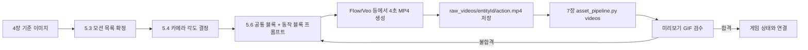
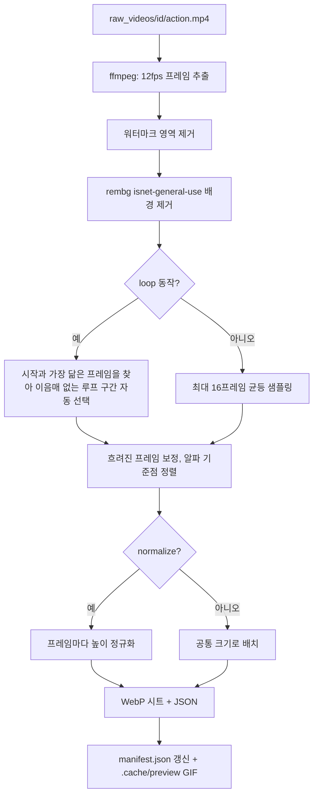
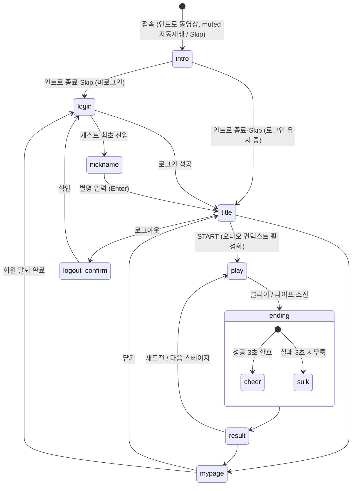
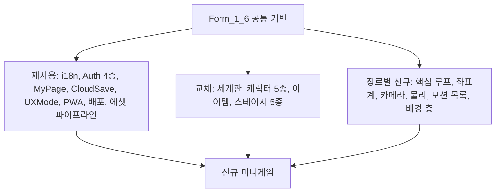

# **미니게임 표준 기획서 (Form_1_6)**

_Universal Mini-Game Master Specification & Production Blueprint — v1.6_  
_검증 참조 프로젝트: **치킨런 v2 (chickenrunv2)** — Vite + Three.js 3D 러너 (실서비스: https://chickenrunv2.web.app , https://chickenrunv2.vercel.app)_  
_이전 참조 프로젝트: 범고래 (Killer Whale) — Form_1_5_2_

---

# **0. 마스터 양식 개요 및 작성 규칙**

본 문서는 미니게임의 **엔진 선정 → 사전 설치 → 기획 → 3D 캐릭터/NPC 모션 영상 제작 → 배경·흐름 에셋 제작 → ffmpeg 컷 추출 파이프라인 → 다국어 UX → 로그인/회원가입/마이페이지/로그아웃 → 관리자 도구 → 배포(GitHub/Firebase/Vercel) → 검증**까지 전 과정을 규정하는 **최상위 표준 기획서(Form_1_6)**이다.

Form_1_6은 Form_1_5_2의 모든 규정을 계승하되, 실제로 완성·배포된 `chickenrunv2`의 최종 코드에서 **검증된 방식**으로 내용을 갱신했다. 문서 안의 규정은 두 종류로 표시한다.

| 표시 | 의미 |
| :--- | :--- |
| ✅ **검증됨** | chickenrunv2에 실제로 구현되어 실서비스에서 동작이 확인된 방식. 그대로 재사용한다. |
| 🟨 **표준 필수 (참조 미구현)** | Form 표준상 필수지만 chickenrunv2에는 아직 없는 기능. 신규 게임에서 반드시 구현한다. |

### 0.1 절대 원칙 (Form_1_5_2 계승 + 보강)
- **절대 코딩 원칙**: 모든 소스 코드, 주석, 변수명, 파일명, 내부 키, 콘솔 로그는 **100% 영어(English Only)**. 게임 데이터(캐릭터명, 스테이지명 등)도 코드 안에서는 영어로 두고, 화면 표시만 i18n 키로 번역한다. ✅
- **다국어 UX 원칙**: 플레이어에게 보이는 모든 텍스트(메뉴, 버튼, 안내, 에러, 툴팁, `aria-label`, `alt`, `placeholder`, 문서 제목)는 한국어(`ko`, 기본), 영어(`en`), 일본어(`ja`) 3개 언어를 지원한다. ✅
- **3D 비주얼 원칙**: 모든 캐릭터·NPC·아이템·장애물은 **배경 없음(Alpha), 테두리 없음(No Outline), 베이크된 그림자 없음(No Drop Shadow)**. ✅
- **움직임 원칙 (v1.6 신설)**: 캐릭터와 NPC는 정지 이미지 + 코드 흔들기로 끝내지 않는다. **AI 동영상(MP4)으로 실제 동작을 만들고, ffmpeg 파이프라인으로 스프라이트 시트(또는 Unity 애니메이션)로 변환**해 상태별로 재생한다. ✅
- **배경 원칙 (v1.6 신설)**: 완성된 풍경화 한 장을 배경으로 쓰지 않는다. **원경(Sky/Far) + 바닥 타일(Ground Tile) + 근경 소품(Props)**으로 분리해 3D 공간에서 조립하여 "길이 흐르는" 화면을 만든다. ✅
- **표준 해상도 & 반응형**: 기준 해상도는 1280×720. UX 프로필 3종(`desktop`, `mobile-landscape`, `mobile-portrait`)을 자동 판별하며, 기기를 회전하면 즉시 레이아웃이 바뀐다. ✅
- **엔진 선정 선행 원칙 (v1.6 신설)**: 코딩 Agent는 첫 코드를 쓰기 전에 **13장 엔진 선정 매트릭스**로 Unity와 Vite + Three.js 중 하나를 고르고, 그 근거를 문서로 남긴다.
- **설치 요청 원칙 (v1.6 신설)**: ffmpeg, Python 패키지, Unity Hub, Firebase CLI 등이 없으면 코딩 Agent는 **임의로 우회하지 말고 사용자에게 설치를 요청**한다(14장의 요청 문구 사용). 자동 설치가 가능한 항목(npm, pip)은 사용자 동의 후 Agent가 직접 설치한다.

### 0.2 Form_1_5_2 → Form_1_6 변경 요약

| 구분 | Form_1_5_2 | Form_1_6 |
| :--- | :--- | :--- |
| 참조 프로젝트 | 범고래 (기획 단계) | chickenrunv2 (실서비스 검증) |
| 엔진 | 미정 (정적 웹 가정) | **13장 엔진 선정 매트릭스**로 Unity 또는 Vite + Three.js 결정 |
| 캐릭터 움직임 | 사인파 부유, 코드 효과 | **AI MP4 → ffmpeg → 스프라이트 시트** 실제 동작 (5장) |
| 배경 | 1920×1080 수평 루프 1장 | **원경 + 바닥 타일 + 소품** 3층 구조 (6장) |
| 에셋 처리 | 수작업 | **`asset_pipeline.py` 자동화** (7장) |
| 언어 토글 | `[KO | EN | JA]` 3버튼 | **순환 버튼 1개** (다음 언어 이름을 영어로 표시) (8장) |
| 게스트 | 세션 종료 시 소멸 | 익명 Auth 삭제 + 기록 **100일 TTL 보관** 후 자동 삭제 (9장) |
| 전화번호 인증 | `{e164}@phone.claypop.invalid` | `{cc}-{number}@phone.{game-id}.app` 가상 이메일 (9장) |
| 로컬 실행 | `python -m http.server` | `npm run dev` (Vite, 포트 3000) (16장) |
| Vercel | `vercel.json` 정적 빌드 | Vite 프리셋 자동 감지, `vercel.json`·환경변수 불필요 (16장) |
| PWA | 아이콘 2종 | `manifest.webmanifest` + any/maskable 아이콘 세트 + 파비콘 (15장) |
| 검증 | Q1~Q10 | **Q1~Q24** (19장) |

### 0.3 문서 사용 방법 (팀 공통)
1. 기획자는 `미니게임_Design_Doc_1_1.md` 템플릿을 복사해 새 게임의 내용(세계관, 캐릭터, 스테이지, 규칙)을 채운다.
2. 코딩 Agent에게는 **이 Form_1_6 + 작성된 Design Doc** 두 파일을 함께 주고, **18장 Agent 작업 지시서**의 단계 순서대로 진행시킨다.
3. 각 단계가 끝나면 19장 체크리스트로 검수한다.

---

# **1. 마스터 문서 메타 정보**

| 항목 | 표준 사양 및 규격 | 작성 예시 (chickenrunv2) |
| :--- | :--- | :--- |
| **게임명** | `{현지화 타이틀}` (한/영/일) | 치킨런 / Chicken Run / チキンラン |
| **영문 식별자 (ID)** | `kebab-case` 또는 `lowercase` | `chickenrunv2` |
| **문서 양식 버전** | **Form_1_6 (v1.6)** | Form_1_6 |
| **엔진 (13장 결정)** | `Vite + Three.js` 또는 `Unity 6 LTS` | Vite 8 + Three.js 0.186 |
| **백엔드** | Firebase (Auth, Firestore, Analytics, Hosting) | Firebase 13 SDK |
| **장르** | `{장르}` | 3D 러너 (세로 쿼터뷰 / 가로 사이드뷰) |
| **타깃 플랫폼** | 모바일 웹(가로·세로), 데스크톱 웹, PWA 설치 | 동일 |
| **플레이 타임** | 판당 1.5~3분, 스테이지 5개 | 스테이지 90~120초 |
| **비주얼 스타일** | Stylized 3D (Alpha, 무테두리, 무그림자) | Pixar풍 3D 카툰 |
| **코드 언어** | English Only | 동일 |
| **UX 언어** | ko(기본), en, ja | 동일 |
| **배포** | localhost → GitHub → Firebase Hosting + Vercel | 동일 |

---

# **2. 표준 폴더 구조 및 에셋 규격**

## 2.1 Vite + Three.js 프로젝트 구조 ✅ (chickenrunv2 실제 구조)

```
📁 {game-id}/
├── index.html                 # 모든 화면 DOM(로그인/타이틀/설정/결과/마이페이지/HUD) + PWA head 태그
├── vite.config.js             # server.port 3000, host true
├── firebase.json / .firebaserc / firestore.rules
├── 📁 src/
│   ├── main.js                # 진입점: i18n.apply() → GameManager 생성
│   ├── style.css              # 전역 스타일 + body[data-ux] 프로필별 레이아웃
│   ├── 📁 core/               # GameManager, GameState(데이터 테이블), SaveSystem, CloudSave,
│   │                          # firebase, i18n, strings, UXMode, WorldScale
│   ├── 📁 renderer/           # GameRenderer (씬, 카메라 프리셋, 스프라이트 빌보드)
│   ├── 📁 world/              # StageWorld, RoadPath, RoadMesh, SkyLayer, PropScatter
│   ├── 📁 animation/          # AnimLibrary (manifest 로더), SpriteAnimator (프레임 재생)
│   ├── 📁 entities/           # Player, Item, Obstacle, BossCat(상태 머신)
│   ├── 📁 managers/           # StageManager (스폰/충돌), ScoreManager (콤보/피버)
│   ├── 📁 input/              # InputManager (키보드, 터치 버튼)
│   ├── 📁 audio/              # SoundSynth (Web Audio 합성 효과음/BGM)
│   └── 📁 ui/                 # AuthUI, AccountUI, IntroCutscene, ResponsiveUIManager
├── 📁 public/                 # 빌드 시 그대로 복사되는 정적 파일 (런타임 에셋)
│   ├── manifest.webmanifest
│   ├── 📁 icons/              # mobile/, desktop/, source/ (15장)
│   └── 📁 assets/
│       ├── 📁 anim/           # {entityId}/{action}.webp + .json, manifest.json  ← 7장 파이프라인 출력
│       ├── 📁 stages/         # stageNN/sky.webp, ground.webp, grass.webp, props/*.webp, stage.json
│       ├── 📁 images/         # characters/, characters/portraits/, npcs/, items/, fixtures/, title/
│       └── 📁 videos/         # intro.mp4
├── 📁 raw_videos/             # AI 생성 원본 MP4: {entityId}/{action}.mp4   (git 추적 권장 X, 용량 큼)
├── 📁 raw_backgrounds/        # AI 생성 원본 배경: stageNN/sky.png, ground_tile.png, props_sheet.png
├── 📁 raw_generated/          # AI 생성 원본 캐릭터/NPC/아이템 PNG (배경 제거 전)
├── 📁 scripts/                # asset_pipeline.py, make_icons.py
└── 📁 .cache/                 # 미리보기 GIF, 테스트 스크린샷, Playwright 테스트 도구 (git 제외)
```

## 2.2 Unity 프로젝트 구조 (13장에서 Unity 선택 시)

```
📁 {GameId}/ (Unity 프로젝트 루트)
├── 📁 Assets/
│   ├── 📁 _Project/
│   │   ├── 📁 Scripts/        # Core/, Gameplay/, UI/, Services/(Auth, Save), Localization/
│   │   ├── 📁 Scenes/         # Boot, Login, Title, Game, Result
│   │   ├── 📁 Prefabs/        # Characters/, Npcs/, Items/, Hazards/, Props/, UI/
│   │   ├── 📁 Art/            # Models/(FBX), Animations/, Sprites/(파이프라인 시트), Materials/, Textures/
│   │   ├── 📁 Stages/         # StageNN/ (Skybox, GroundTile, Props, StageData.asset)
│   │   ├── 📁 Audio/          # BGM/, SFX/
│   │   ├── 📁 Localization/   # String Tables (ko, en, ja)
│   │   └── 📁 Data/           # ScriptableObject: CharacterData, StageData, ItemData
│   └── 📁 StreamingAssets/    # intro.mp4
├── 📁 Packages/  📁 ProjectSettings/
└── 📁 RawAssets/              # raw_videos, raw_backgrounds, raw_generated (Unity 임포트 대상 아님)
```

## 2.3 에셋 기술 규격표

| 에셋 | 형식 | 해상도/크기 | 규칙 |
| :--- | :--- | :--- | :--- |
| 인트로 동영상 | MP4 (H.264 + AAC) | 1280×720, 6초 내외 | 1.5MB 목표, `muted` 자동재생 + 사운드 토글, Skip 버튼 |
| 캐릭터/NPC 기준 이미지 | PNG RGBA | 1024×1024 이상 | 전신, 정면 3/4, 배경 단색(파이프라인이 제거) |
| 캐릭터/NPC 모션 원본 | MP4 | 16:9, 1280×720 이상, 4초 | 5장 규격 |
| 모션 스프라이트 시트 | WebP + JSON | 프레임 높이 256px(대형 보스 320px), 시트 폭 ≤ 4096px | 7장 파이프라인 출력 |
| 원경 `sky` | PNG → WebP | 2:1 (예: 2048×1024) | 길·전경 없음, 하단 30% 연무 |
| 바닥 타일 `ground_tile` | PNG → WebP | 1:2 (예: 1024×2048) | 완전 수직 내려다본 정사영, 위·아래 이음매 일치 |
| 소품 `props_sheet` | PNG → WebP 개별 컷 | 3:2, 6개 3×2 격자 | 서로 겹치지 않게, 단색 배경 |
| 아이템 | PNG RGBA | 256~512px | 무테두리·무그림자 |
| 앱 아이콘 | PNG / ICO | 15장 표 참조 | any + maskable |

---

# **3. 3D 비주얼 디자인 및 렌더링 규격**

### 3.1 핵심 3대 렌더링 원칙 (Form_1_5_2 계승) ✅
- **No Background**: 모든 스프라이트는 알파 채널 유지. AI 생성 시에는 **단색 밝은 회색 배경**으로 만들고 파이프라인(rembg)이 제거한다. 흰색 배경은 흰 깃털·흰 공과 구분이 어려우므로 피한다.
- **No Border / No Outline**: 검정/유색 외곽선 금지. 볼륨은 셰이딩과 림라이트로 표현.
- **No Drop Shadow**: 이미지에 바닥 그림자를 굽지 않는다. 필요한 그림자는 엔진에서 블롭(원형 반투명 메시)으로 붙인다.

### 3.2 렌더링 방식 결정 (v1.6 신설)

| 방식 | 설명 | 적합한 게임 | chickenrunv2 |
| :--- | :--- | :--- | :--- |
| **A. 3D 월드 + 2D 빌보드 스프라이트** | 땅·길·하늘은 3D, 캐릭터·NPC는 카메라를 향하는 스프라이트 시트 | 러너, 탑다운 슈팅, 타워디펜스, 드론 폭격 | ✅ 채택 |
| **B. 완전 3D 모델 (FBX/GLB + 리깅)** | 캐릭터를 3D 모델로, 동작을 스켈레탈 애니메이션으로 | 테니스, 골프 드라이버처럼 카메라가 캐릭터 주위를 돈다면 필수 | — |
| **C. 혼합** | 주인공은 3D 모델, 원거리 군중/NPC는 빌보드 | 테니스 관중, 골프 갤러리 | — |

- 카메라가 캐릭터를 **항상 같은 방향(뒤·옆·위)**에서 본다면 A로 충분하다. 동영상 한 방향 = 스프라이트 한 방향이다.
- 카메라가 캐릭터를 **자유롭게 회전**한다면 B가 필요하다. 이때 5장의 동영상은 "모션 레퍼런스"로 쓰고, 3D 모델은 별도로 만든다(5.8절).

### 3.3 공간 좌표계 원칙 ✅
- 모든 게임 오브젝트는 **게임 좌표**로 위치를 저장하고, 월드 좌표 변환은 한 함수가 담당한다.
  - 러너(chickenrunv2): `(s = 길 중심선 거리, lane = -1~+1 좌우, h = 높이)` → `RoadPath.toWorld(s, lane, h)`.
  - 테니스: `(courtX, courtY, height)` — 코트 크기 23.77×10.97m 기준.
  - 타워디펜스: `(gridCol, gridRow)` + 경로 웨이포인트.
  - 골프: 실제 미터 단위 `(x, y, z)` + 지형 높이 함수.
- 엔티티 크기는 상수 하나로 일괄 조정한다(chickenrunv2: `ENTITY_SCALE = 1.5`, `ROAD_SCALE = 1.2`).

---

# **4. 기본 캐릭터 및 NPC 생성 (기준 이미지)**

모든 모션 영상은 **기준 이미지 1장**을 레퍼런스(Flow/Veo의 Ingredients, Kling/Runway의 Image-to-Video)로 넣어 만든다. 기준 이미지가 흔들리면 모든 모션이 서로 다른 캐릭터처럼 보인다.

### 4.1 등장 엔티티 분류표 (Design Doc에서 작성)

| 분류 | 설명 | 최소 동작 수 | 예시 |
| :--- | :--- | :--- | :--- |
| **Player Character** (5종 권장) | 플레이어가 고르는 주인공 | 5개 (기본 이동, 액션, 피격, 실패, 승리) | 치킨 5종, 테니스 선수 5명 |
| **Boss / Chaser NPC** | 스테이지 끝 추격·대결 상대 | 8~15개 (상태 머신 상태마다 1개) | 심술 고양이 15개 |
| **Moving Hazard NPC** | 움직이는 장애물·적 | 1~3개 (이동, 공격, 퇴장) | 개, 돌진 소 |
| **Static Fixture** | 움직이지 않는 장애물 | 0개 (PNG 1장) | 건초더미, 울타리 |
| **Item / Pickup** | 수집물 | 0개 (코드 회전·부유) | 쌀, 옥수수, 고추 |

### 4.2 기준 이미지 프롬프트 템플릿

```text
[Character Reference Sheet]
A single full-body {CHARACTER DESCRIPTION: species/role, body shape, outfit, colors with hex codes,
signature accessory}, standing in a neutral ready pose, three-quarter front view, whole body visible
from head to feet with margin around it, centered.
Stylized 3D Pixar-style cartoon, soft toon shading, vibrant colors, clean game asset.
Plain solid light gray background (#D9D9D9), no ground plane, no cast shadow, no outline, no text,
no watermark. Square 1:1.
```

- 같은 캐릭터의 **정면 / 측면 / 후면** 3장을 추가로 만들면(Turnaround) 후면·측면 시점 동영상의 일관성이 크게 좋아진다.

```text
[Turnaround Sheet]
Character turnaround sheet of the same {CHARACTER} as the attached image: front view, right side view,
back view, standing side by side with large spacing, identical proportions and colors, neutral pose,
plain solid light gray background, no shadows, no text. 3:1 wide.
```

### 4.3 파일 규칙
- 기준 이미지: `raw_generated/{entityId}.png` → 파이프라인 `sprites` 명령이 배경을 제거해 `public/assets/images/characters|npcs/{entityId}.png`로 출력.
- 초상화(선택 화면용): 파이프라인 `portraits` 명령이 `characters/portraits/{id}.png`(상반신)와 `{id}_head.png`(얼굴)를 만든다. ✅

---

# **5. 캐릭터 & NPC 3D 모션 동영상(MP4) 제작 규격 및 프롬프트**

### 5.1 제작 흐름


### 5.2 동영상 제작 9대 규격 ✅ (chickenrunv2 검증)
1. **길이 4초**, 16:9, **1280×720 이상**, 24fps 이상.
2. **기준 이미지를 레퍼런스로 첨부**한다(Flow/Veo: Ingredients to Video).
3. **배경은 단색 밝은 회색 스튜디오**. 바닥 무늬, 소품, 다른 생물, 그림자 없음.
4. **피사체 1개만** 등장한다.
5. **카메라가 피사체를 따라가며(tracking) 화면 중앙·일정 크기를 유지**한다. 피사체가 화면 밖으로 나가거나 크기가 변하면 프레임 정렬이 깨진다.
6. **전신이 항상 화면 안**에 있다(머리·발·꼬리 잘림 금지).
7. **반복 동작(loop)**: 시작 포즈와 끝 포즈가 같아야 한다(달리기, 걷기, 대기).
8. **1회 동작(one-shot)**: 0.3초 준비 자세 → 동작 → 마지막 포즈 0.5초 정지(점프, 피격, 승리, 서브).
9. **글자·워터마크·자막 없음**. (Veo 우하단 워터마크는 파이프라인이 잘라내지만, 피사체가 그 영역에 들어가지 않게 한다.)

### 5.3 동작(모션) 목록 설계 규칙
- **게임 상태 머신의 상태 하나 = 동영상 하나**. 먼저 상태 목록을 만들고, 상태마다 필요한 클립을 표로 정리한다.
- 같은 동작이라도 **카메라에서 보이는 방향이 다르면 다른 클립**이다(예: 고양이 `run_back` 뒷모습, `run_diag` 대각선).
- **좌우 대칭 동작은 오른쪽만 만들고 코드에서 좌우 반전**한다(`SpriteAnimator.setFlip`). 제작량이 절반이 된다. ✅

#### chickenrunv2 실제 클립 목록 (manifest.json) ✅

| 엔티티 | 클립 | 종류 |
| :--- | :--- | :--- |
| 주인공 5종 (funny_chicken, rooster_king, speedy_chick, daffy_duck, turbo_turkey) | `run`, `jump`, `hit`, `caught`, `victory` | run=loop, 나머지 one-shot |
| 보스 cat_grumpy | `walk`, `chase`, `run_back`, `run_diag`, `crouch`, `pounce`, `swipe`, `hiss`, `taunt`, `angry`, `dizzy`, `faceplant`, `miss_tumble`, `launched`, `defeated` (15개) | walk/chase/run_*=loop |
| dog, cow_rushing | `move` | loop |

#### 장르별 표준 모션 목록 (신규 게임 착수 시 출발점)

| 게임 | 주인공 필수 모션 | NPC/상대 필수 모션 |
| :--- | :--- | :--- |
| **3D 테니스** | `idle_ready`, `run_left`(→반전으로 right), `run_forward`, `run_back`, `serve`, `forehand`, `backhand`, `volley`, `smash`, `dive`, `point_win`, `point_lose`, `victory`, `defeat` | 상대 선수(동일 세트, 반대 코트 시점), 볼보이 `run`, 심판 `call` |
| **타워디펜스** | 타워별 `idle`, `attack`, `upgrade` (탑다운 45°) | 적 유닛별 `walk`, `hit`, `die`, (보스) `special` |
| **슈팅 게임** | 기체 `fly_idle`, `bank_left`(반전), `boost`, `fire`, `hit`, `explode` | 적 기체 `fly`, `fire`, `explode`, 보스 `phase1`, `phase2`, `death` |
| **골프 퍼팅** | `address`, `practice_stroke`, `putt_short`, `putt_long`, `wait_ball`, `celebrate`, `disappointed` | 캐디 `point`, 갤러리 `clap`(빌보드) |
| **골프 드라이버** | `address`, `backswing`, `downswing_impact`, `follow_through`, `watch_ball`, `celebrate`, `slice_reaction` | 갤러리 `clap`, `cheer` |
| **드론 폭탄** | 드론 `hover`, `fly_forward`, `bank_left`(반전), `drop_bomb`, `hit`, `crash` | 지상 목표 `move`, `alert`, `destroyed`, 대공포 `aim`, `fire` |

### 5.4 카메라 각도 결정 규칙 ✅
- **동영상 카메라 각도 = 게임 카메라가 그 엔티티를 보는 각도.** 게임 화면을 먼저 정하고 그에 맞춰 찍는다.
- chickenrunv2 예: 플레이어 뒤에서 쫓아오는 고양이는 화면 아래쪽(카메라 가까이)에 있으므로 **뒷모습/뒤 3/4**으로 제작, 플레이어 캐릭터도 뒤 3/4 달리기.

| 게임 카메라 | 영상 카메라 지정 문구 |
| :--- | :--- |
| 3인칭 뒤 추적 (러너, 드라이버) | `camera behind the subject at rear three-quarter view, slightly above` |
| 사이드뷰 (가로 러너, 2D 슈팅) | `pure side view from the right, camera at subject height` |
| 탑다운 45° (타워디펜스, 드론) | `high three-quarter top-down view from 45 degrees above` |
| 정탑다운 (슈팅 기체) | `straight top-down view looking directly down` |
| 방송 중계 (테니스) | `broadcast tennis camera high behind the baseline` |

### 5.5 정규화(normalize) 모드가 필요한 경우 ✅
- 피사체가 카메라 쪽으로 다가오거나 멀어지는 동작(돌진, 덮치기, 날아감)은 프레임마다 크기가 달라진다. 이 경우 파이프라인을 `normalize` 모드로 처리하여 매 프레임 같은 높이로 맞추고, 원근감(커짐)은 엔진에서 스케일로 연출한다.

### 5.6 프롬프트 = [공통 블록] + [동작 블록]

```text
[COMMON BLOCK — 모든 클립에 동일하게 붙인다]
Use the attached image as the exact character reference: keep the same face, proportions, colors and
outfit in every frame. Single subject only. Plain solid light gray studio background with no floor
pattern, no props, no other characters, no shadows. The camera tracks the subject smoothly so it stays
centered and the same size in frame for the whole clip; the full body from head to feet (and tail) is
always visible with margin. Stylized 3D Pixar-style animation, soft toon shading, smooth natural motion.
No text, no subtitles, no logo, no watermark. 4 seconds, 16:9.
```

```text
[ACTION BLOCK — LOOP 예시: run]
{CAMERA ANGLE}. The {character} runs in place on an invisible treadmill with an energetic, bouncy
cartoon run cycle: wings/arms pumping, legs alternating, head bobbing. The motion is a perfect loop:
the first and last frames show the same pose. The subject does not move across the frame.
```

```text
[ACTION BLOCK — ONE-SHOT 예시: jump]
{CAMERA ANGLE}. The {character} stands in a ready crouch for 0.3 seconds, springs high into the air with
a joyful tuck, lands softly, then holds the final landed pose still for the last 0.5 seconds. The camera
follows vertically so the full body stays in frame at the top of the jump.
```

#### 동작 블록 사전 (복사해서 {character}, {CAMERA ANGLE}만 바꿔 사용)

| 동작 키 | 동작 블록 핵심 문장 |
| :--- | :--- |
| `idle` (loop) | `breathes gently and shifts weight from foot to foot, blinking, perfect loop` |
| `walk` (loop) | `walks in place on an invisible treadmill with a relaxed stride, perfect loop` |
| `run` (loop) | 위 예시 |
| `jump` | 위 예시 |
| `hit` | `gets bumped from the front, recoils backward with a dizzy wobble and stars, recovers to a standing pose and holds it for 0.5 s` |
| `caught` / `defeat` | `slumps sadly, shoulders drop, head hangs, sits down and holds the sulking pose for 0.5 s` |
| `victory` | `jumps and spins with joy, raises wings/arms, lands and holds a proud triumphant pose for 0.5 s` |
| `attack` / `swipe` | `winds up, swipes forward quickly with one paw/arm, returns to ready pose and holds it` |
| `serve` (테니스) | `tosses the ball up, arches back, swings the racket overhead to hit a serve, follows through and holds` |
| `forehand` / `backhand` | `steps into a {forehand/backhand} swing with full rotation of the torso, follows through and holds` |
| `putt` (골프) | `in address over the ball, makes a smooth pendulum putting stroke, keeps the head still and holds the finish` |
| `drive` (골프) | `takes a full backswing, powerful downswing through impact, high balanced follow-through, holds the finish` |
| `hover` (드론, loop) | `hovers in place, rotors spinning, gentle bobbing, perfect loop` |
| `explode` / `crash` | `shudders, emits smoke and a cartoon burst, breaks apart; final frame shows debris fading` |

### 5.7 클립 요청서 작성 양식 (Design Doc 부록으로 첨부)

| # | 엔티티 | 동작 키 | loop/one-shot | 카메라 각도 | 게임 상태와의 연결 | 프롬프트(동작 블록) |
| :-: | :--- | :--- | :--- | :--- | :--- | :--- |
| 1 | `cat_grumpy` | `run_back` | loop | rear 3/4 | `STALK` 상태 | ... |

> chickenrunv2의 실제 요청서 예: `Cat_Animation_Request.md` (상태 vs 카메라 분석 → 필요 클립 표 → 9대 규격 → 11개 프롬프트 → 상태-클립 매핑).

### 5.8 완전 3D 모델이 필요한 경우 (3.2의 방식 B)
- 동영상만으로는 회전 가능한 3D 모델이 나오지 않는다. 다음 중 하나를 사용한다.
  1. **Image-to-3D** (Meshy, Tripo, Rodin 등): 4.2의 Turnaround 시트로 GLB/FBX 생성.
  2. **자동 리깅**: Mixamo(인간형) 또는 AccuRIG에 업로드해 스켈레톤 생성.
  3. **모션**: Mixamo 라이브러리, 또는 5장 MP4를 **비디오 모션 캡처**(Rokoko Vision, DeepMotion 등)로 변환해 리깅된 모델에 적용.
- Three.js는 `GLTFLoader` + `AnimationMixer`, Unity는 Humanoid Avatar + Animator Controller로 재생한다.
- 비인간형(드론, 동물)은 Mixamo가 안 되므로 Blender에서 간단한 본/키프레임 애니메이션을 만들거나 방식 A(스프라이트)를 쓴다.

---

# **6. 배경 이미지 및 배경 흐름용 추가 이미지 규격과 프롬프트**

### 6.1 왜 한 장짜리 배경을 쓰지 않는가 ✅
완성된 풍경화 한 장은 아무리 스크롤해도 "길이 흐르는" 3D 느낌이 나지 않고, 길의 위치를 코드가 알 수 없어 NPC를 길 위에 올릴 수 없다. 그래서 배경을 **3개 층 + 보조 1개**로 나눈다. 기존 한 장짜리 이미지(`backgrounds/stageNN.png`)는 스테이지 선택 카드·결과 화면 배경으로 재활용한다.

| 층 | 파일 | 비율/크기 | 엔진에서의 역할 (chickenrunv2) |
| :--- | :--- | :--- | :--- |
| **원경 Far** | `sky.png` | 2:1, 2048×1024 | 카메라에 붙은 배경판(`SkyLayer`), 길 방향에 따라 0.2배 시차 이동. 하단 연무가 안개(Fog)와 섞임 |
| **바닥 Ground** | `ground_tile.png` | 1:2, 1024×2048 | 길 리본 메시(`RoadMesh`)에 반복 매핑, V좌표를 이동 거리에 묶어 바닥이 흘러옴 |
| **풀/가장자리 Grass** | (자동 추출) `grass.webp` | 파이프라인 생성 | 길 바깥 스커트 영역 |
| **근경 Props** | `props_sheet.png` | 3:2, 6개 격자 | 길 양옆에 거리·간격 무작위 배치되는 빌보드(`PropScatter`), 풀링 재사용 |

### 6.2 장르별 배경 층 구성

| 게임 | 원경 | 바닥/지형 | 근경/소품 | 흐름 방식 |
| :--- | :--- | :--- | :--- | :--- |
| 러너 (chickenrunv2) | 하늘·산 파노라마 | 세로 반복 길 타일 | 나무, 헛간, 울타리 | 바닥 UV 스크롤 + 소품 재배치 |
| **3D 테니스** | 경기장 관중석 파노라마(360° 또는 4면) | 코트 표면 텍스처(하드/클레이/잔디) **비반복 1장** + 코트 라인 | 네트, 심판석, 광고판 | 흐름 없음, 카메라만 이동 |
| **타워디펜스** | 맵 테두리 원경(선택) | **탑다운 정사영 타일셋**(길, 잔디, 물, 바위) 그리드 | 나무, 바위, 건물 | 흐름 없음, 웨이브 진행 |
| **슈팅 (종스크롤)** | 우주/하늘 원경 1~2층 시차 | 세로 반복 지형 타일 | 구름, 소행성(시차 다층) | 다층 시차 스크롤 |
| **골프 퍼팅** | 스카이박스(6면 또는 등장방형 2:1) | 그린 텍스처 + **높이맵(경사)** | 깃대, 벙커 가장자리, 나무 | 흐름 없음 |
| **골프 드라이버** | 스카이박스 + 원거리 산 | 페어웨이·러프·벙커 **타일 텍스처 세트** | 나무, 거리 표지판, 갤러리 | 공 비행 중 카메라 추적 |
| **드론 폭탄** | 하늘/지평선 원경 | **탑다운 도시/지형 반복 타일** | 건물 지붕, 차량, 나무 | 바닥 스크롤 또는 자유 비행 |

### 6.3 공통 스타일 블록
```text
[STYLE BLOCK — 모든 배경 프롬프트 끝에 붙인다]
Stylized 3D Pixar-style cartoon, soft toon shading, vibrant colors, clean game asset.
```
- 기존 키아트나 이전 스테이지 배경을 **스타일 레퍼런스로 첨부**하면 스테이지 간 그림체가 맞는다.
- Gemini/AI Studio(나노바나나)는 `--ar` 옵션을 인식하지 않는다. 비율은 문장으로 쓰고("Wide 2:1 landscape format") 화면 비율 설정에서 고른다. ✅

### 6.4 원경(Far) 프롬프트 템플릿 ✅
```text
Using the attached image only as a style and color reference, create a wide panoramic distant background
for a {GENRE} game. {SETTING} seen far away: {3~5 distant landmarks}, {sky and weather}, {lighting/time}.
There is NO road, NO path and NO foreground objects. The bottom 30% of the image softly fades into a light
haze so it can blend with a 3D ground. Colors: {hex palette}. [STYLE BLOCK] Wide 2:1 landscape format.
```

### 6.5 바닥 타일(Ground Tile) 프롬프트 템플릿 ✅ (가장 중요, 가장 실패하기 쉬움)
```text
Create a seamless vertically tileable ground texture for a 3D {GENRE} game. Strict top-down orthographic
view looking straight down at the ground, absolutely NO perspective and NO horizon. A straight {path
material} runs vertically through the exact center of the image, occupying the middle 50% of the width,
with exactly the same width from top to bottom and soft natural edges. On the path: {small details}.
On both sides: {side surface details}. Flat, even, shadowless lighting. The top edge and bottom edge must
match perfectly so the image repeats endlessly. Colors: {hex}. [STYLE BLOCK] Tall 1:2 portrait format.
```
- **실패 신호**: 길이 위로 갈수록 좁아짐(원근), 길이 휘어짐, 위·아래 끝 색이 다름 → 파이프라인이 `perspectiveWarning`을 기록한다. 재생성하거나 `ROAD_OVERRIDES`로 길 좌우 위치를 수동 지정한다.
- 타워디펜스/드론처럼 길이 없는 지형은 "path" 문장을 빼고 **"seamless in all four directions"**로 바꾼다.

### 6.6 소품 시트(Props Sheet) 프롬프트 템플릿 ✅
```text
Using the attached image only as a style reference, create a game asset sheet of 6 separate {THEME} props
arranged in a neat 3 by 2 grid with large empty spacing between them; no object touches or overlaps
another. Each prop is shown whole, centered in its cell, in a three-quarter front view: 1) {..} 2) {..}
3) {..} 4) {..} 5) {..} 6) {..}. Plain solid light gray background, no ground plane, no cast shadows,
no text. [STYLE BLOCK] 3:2 landscape format.
```

### 6.7 장르별 추가 프롬프트

```text
[Tennis Court Surface — non-tiling]
Strict top-down orthographic texture of a full {hard/clay/grass} tennis court surface with crisp white
regulation lines, exact 2:1 proportions of a doubles court plus run-off area, no net, no players, no
shadows, flat even lighting. [STYLE BLOCK] Wide 2:1 format.

[Stadium Backdrop]
Panoramic tennis stadium stands full of cheerful cartoon spectators seen from court level, colorful
banners, blue sky above, bottom edge is the stadium wall line, no court visible. [STYLE BLOCK] Wide 4:1.

[Tower Defense Tileset]
Top-down orthographic tileset sheet on a 4 by 4 grid of square tiles: grass, dirt path straight,
path corner, path T-junction, water, shore edge, rocks, flowers, each tile seamless with its
neighbors, flat lighting, no shadows. [STYLE BLOCK] Square 1:1.

[Golf Green]
Strict top-down orthographic texture of a golf putting green with fine mowing stripes and a fringe
border, circular cup area at center left empty, no flag, no ball, flat even lighting. [STYLE BLOCK] 1:1.

[Skybox Equirectangular]
360-degree equirectangular panorama of {sky/landscape}, horizon exactly at the vertical center,
seamless left and right edges, no ground objects closer than the far hills. [STYLE BLOCK] 2:1.

[Drone City Tile]
Seamless tileable strict top-down orthographic view of a cartoon city block: rooftops, streets, small
cars, trees, flat lighting, no perspective, all four edges match. [STYLE BLOCK] Square 1:1.
```

### 6.8 스테이지별 배경 설계표 (Design Doc에 작성)

| 스테이지 | 원경 | 바닥 (길 / 양옆) | 소품 6종 | 특수 처리 |
| :--- | :--- | :--- | :--- | :--- |
| 1 Farm Yard ✅ | 초록 언덕, 풍차, 맑은 하늘 | 흙 자갈길 / 잔디·들꽃 | 빨간 헛간, 사과나무, 울타리, 건초더미, 술통, 오리 연못 | — |
| 3 Farmhouse ✅ | (하늘 대신) 창호지 문 벽 | 마루 / 장판 | 장독, 소반 등 | 실내: 원경이 벽 |
| 4 Mountain ✅ | 노을 산맥 | 비탈 흙길 / 바위 | 바위, 고목 | 구간 특수 이미지(출렁다리) 별도 |

### 6.9 원본 저장 규칙
```
raw_backgrounds/
└── stage01/
    ├── sky.png
    ├── ground_tile.png
    └── props_sheet.png   (또는 props/*.png 개별)
```

---

# **7. ffmpeg 기반 컷(프레임) 추출 및 에셋 파이프라인**

### 7.1 설치 확인 및 요청 (코딩 Agent 필수 절차)
코딩 Agent는 파이프라인 작업 전에 아래를 확인하고, **없으면 사용자에게 설치를 요청**한다.

```powershell
ffmpeg -version          # 없으면 요청 (또는 pip의 imageio-ffmpeg 대체 사용)
python --version         # 3.10 이상
pip show rembg pillow numpy imageio-ffmpeg
```

**설치 요청 문구 (Agent → 사용자)**
> 캐릭터·NPC 동영상을 스프라이트 컷으로 자르려면 **ffmpeg**와 Python 패키지가 필요합니다.  
> 1) ffmpeg: PowerShell에서 `winget install --id Gyan.FFmpeg -e` 실행 후 터미널을 다시 열어 주세요. (macOS: `brew install ffmpeg`)  
> 2) Python 패키지: `pip install "rembg[cpu]" pillow numpy imageio-ffmpeg` — 동의해 주시면 제가 직접 설치하겠습니다.  
> ffmpeg 설치가 어려우면 `imageio-ffmpeg`에 포함된 ffmpeg로 대신 진행할 수 있습니다.

- rembg 첫 실행 시 배경 제거 모델(`isnet-general-use`, 약 170MB)을 자동 다운로드한다. 인터넷 연결이 필요하다고 미리 알린다.

### 7.2 파이프라인 명령 ✅ (`scripts/asset_pipeline.py`)

```powershell
python scripts/asset_pipeline.py videos                                   # raw_videos 전체
python scripts/asset_pipeline.py videos --char cat_grumpy --action pounce # 한 클립만
python scripts/asset_pipeline.py backgrounds [--stage 1]                  # sky/ground/grass/stage.json
python scripts/asset_pipeline.py props [--stage 1]                        # 소품 컷아웃
python scripts/asset_pipeline.py sprites                                  # raw_generated 배경 제거
python scripts/asset_pipeline.py portraits                                # 선택 화면 초상화
python scripts/asset_pipeline.py all
```

### 7.3 동영상 → 스프라이트 시트 처리 단계 ✅


- ffmpeg 추출 명령 예: `ffmpeg -i in.mp4 -vf "fps=12" -q:v 2 frames/%04d.png`
- 수동 확인용 GIF: `ffmpeg -framerate 12 -i frames/%04d.png -vf "scale=256:-1" preview.gif`

### 7.4 출력 형식 ✅
`public/assets/anim/{entityId}/{action}.json`
```json
{ "frameCount": 12, "fps": 12, "frameWidth": 230, "frameHeight": 256, "loop": true,
  "pivot": [0.5, 0.0] }
```
`public/assets/anim/manifest.json`
```json
{ "funny_chicken": ["caught", "hit", "jump", "run", "victory"], "dog": ["move"] }
```
- 프레임 높이 256px(대형 보스 320px), 시트 폭 4096px 이하(모바일 GPU 한계).
- `pivot`은 발바닥 중앙. 엔진은 이 점을 지면에 맞춘다.

### 7.5 배경 처리 단계 ✅
1. 원경: Gemini 반짝이 워터마크 제거, 하늘에서 **`fogColor` 자동 추출**(안개 색 = 원경 하단 색).
2. 바닥 타일: 위·아래 경계를 크로스페이드해 **세로 이음매 없게** 만들고, 열(column) 분석으로 **길의 좌우 위치 `roadU0`/`roadU1`** 검출. 잔디 띠를 잘라 `grass.webp` 생성.
3. 소품: rembg로 개별 컷아웃 → `props/*.webp` + 가로세로비.
4. 결과 `stage.json`:
```json
{ "sky": "sky.webp", "ground": "ground.webp", "grass": "grass.webp", "groundAspect": 0.5,
  "roadU0": 0.31, "roadU1": 0.69, "fogColor": "#cfe3ea", "perspectiveWarning": false,
  "props": [{ "name": "barn", "file": "props/barn.webp", "aspect": 1.21 }] }
```

### 7.6 검수 기준
- `.cache/preview/{id}_{action}.gif`를 열어 **튐(jitter), 깜빡임, 잘림, 남은 배경 얼룩**이 없는지 본다.
- 루프 클립은 마지막→첫 프레임 전환이 끊기지 않아야 한다.
- 불합격 시 프롬프트를 고쳐 재생성한다(카메라 고정·피사체 중앙 문장을 강화).

### 7.7 Unity로 가져갈 때
- WebP 시트는 PNG로 변환(`ffmpeg -i x.webp x.png`) 후 Sprite Mode = Multiple, Grid By Cell Size(`frameWidth`×`frameHeight`)로 자르고, Animation Clip(fps = JSON의 `fps`)을 만든다. 또는 JSON을 읽는 Editor 스크립트로 자동화한다.
- 3D 모델 방식이면 이 장은 모션 레퍼런스 확인용으로만 쓴다.

---

# **8. 다국어(i18n) 세팅 프로세스**

### 8.1 구조 ✅
| 파일 | 역할 |
| :--- | :--- |
| `src/core/strings.js` | 모든 문구 사전: `STRINGS['key'] = { ko, en, ja }`. 변수는 `{name}` 자리표시자 |
| `src/core/i18n.js` | `t(key, vars)`, `i18n.set(lang)`, `i18n.cycle()`, `i18n.subscribe(fn)`, `i18n.apply(root)`, `i18n.locale()` |
| `index.html` | 정적 문구는 `data-i18n*` 속성으로 지정 |

- 기본 언어 `ko`, 저장 키 `localStorage['{GAME}_LANG']`, 시작 시 `<html lang>` 갱신.
- 게임 데이터는 영어로 두고 표시용 헬퍼로 번역: `charText(ch, 'name')` → `t('char.{id}.name')`, `stageName(stage)`, `obstacleName(key)`.

### 8.2 DOM 속성 규칙 ✅
| 속성 | 번역 대상 |
| :--- | :--- |
| `data-i18n="key"` | `textContent` |
| `data-i18n-html="key"` | `innerHTML` (줄바꿈 `<br>` 포함 문구) |
| `data-i18n-ph="key"` | `placeholder` |
| `data-i18n-title="key"` | `title` 툴팁 |
| `data-i18n-aria="key"` | `aria-label` |
| `data-i18n-alt="key"` | `alt` |
| `data-i18n-args='{"n":3}'` | 위 속성들의 변수 값 |

### 8.3 세팅 순서 (신규 게임)
1. `strings.js`, `i18n.js`를 복사한다.
2. 화면을 만들 때 **처음부터** 문구를 직접 쓰지 말고 키를 만든다. 키 이름은 `화면.요소` 형식: `login.title`, `auth.err.emailEmpty`, `result.retry`.
3. HTML 정적 문구 → `data-i18n*` 속성. JS에서 만드는 문구 → `t('key', vars)`.
4. JS로 그린 화면은 `i18n.subscribe(() => this.render())`로 언어 변경 시 다시 그린다. 메시지 영역은 **키를 기억했다가** 언어가 바뀌면 다시 번역한다(`setMessage(key, vars)` → `refreshMessage()`).
5. 숫자·날짜는 `toLocaleString(i18n.locale())` / `toLocaleDateString(i18n.locale())`.
6. 언어별 예시가 다른 입력은 `data-i18n-ph`로 placeholder를 바꾼다. chickenrunv2는 국가번호 입력값을 `+82`로 두고 placeholder만 ko/en `10 1234 5678`, ja `90 1234 5678`로 바꾼다. ✅ 해외 이용자가 많은 게임은 언어 변경 시 국가번호 기본값도 함께 바꾼다(ko `+82`, en `+1`, ja `+81`).
7. **누락 검사**: 3개 언어 각각 모든 화면을 캡처하는 자동 테스트(Playwright)로 빈 문구·키 노출·넘침을 확인한다(19장).

### 8.4 언어 버튼 표준 ✅
- 버튼 1개가 `ko → en → ja → ko` 순환. 버튼 글자는 **다음 언어 이름을 영어로**: 한국어 화면 `English`, 영어 화면 `Japanese`, 일본어 화면 `Korean`. 툴팁(`lang.title`)은 현재 언어로 "영어로 변경 / Switch to Japanese / 韓国語に切り替え".
- 위치: 계정 바(우측 상단) **마이페이지 버튼 왼쪽**. 로그인 화면에는 계정 바가 없으므로 우측 상단 떠 있는 버튼(`#lang-float`)으로 표시.

### 8.5 다국어 레이아웃 규칙 ✅ (UX 감사에서 확인된 문제와 해결)
- 한국어 `word-break: keep-all`, **일본어는 `word-break: normal`**(일본어에 keep-all을 쓰면 줄이 안 바뀌어 넘친다).
- 버튼 글자가 넘치면 글자를 줄이지 말고 **버튼을 2열/2줄로 배치**한다. 가로 메뉴가 겹치거나 찌그러지면 2열 그리드로 바꾼다.
- 중앙 배너는 `left:50%` 절대배치 시 폭이 반으로 제한되므로 `width:max-content; max-width:calc(100% - 24px)`.
- 메시지 텍스트는 가운데 정렬·줄 간격 통일.

### 8.6 i18n 사전 예시 (Form_1_5_2 계승, 실제 키 형식)
```javascript
export const STRINGS = {
  'login.title': { ko: '로그인', en: 'Login', ja: 'ログイン' },
  'auth.err.emailEmpty': { ko: '이메일을 입력하세요', en: 'Enter an email', ja: 'メールアドレスを入力してください' },
  'auth.err.pwMismatch': { ko: '비밀번호가 일치하지 않습니다', en: 'Passwords do not match', ja: 'パスワードが一致しません' },
  'result.cheer': { ko: '스테이지 정복 성공!', en: 'Stage Cleared!', ja: 'ステージクリア成功！' },
  'hud.combo': { ko: '{n} 콤보', en: '{n} Combo', ja: '{n} コンボ' },
  'lang.label': { ko: 'English', en: 'Japanese', ja: 'Korean' }
};
```

---

# **9. 사용자 생명주기, 로그인/회원가입/마이페이지/로그아웃 세팅**

## 9.1 상태 전이 다이어그램


## 9.2 Firebase 프로젝트 세팅 절차 (사람이 Console에서 할 일)
1. [Firebase Console](https://console.firebase.google.com) → 프로젝트 추가 → **웹 앱 추가** → SDK 설정값을 `src/core/firebase.js`에 넣는다. (웹 API 키는 공개용이라 코드에 넣어도 되며, 보안은 규칙이 담당한다. Vercel 환경변수 불필요.) ✅
2. **Authentication → 로그인 방법** 사용 설정: `익명`, `Google`, `이메일/비밀번호`.
3. **Authentication → 설정 → 승인된 도메인**: `localhost`, `{project}.web.app`, `{project}.firebaseapp.com`, `{project}.vercel.app`, 커스텀 도메인 추가. (빠뜨리면 Google 로그인 팝업이 실패한다.) ✅
4. **Firestore Database** 생성(프로덕션 모드, 지역 `asia-northeast3` 서울 권장) → 9.6의 규칙 배포.
5. **Firestore → TTL 정책**: 컬렉션 `users`, 필드 `expireAt` (게스트 기록 자동 삭제). ✅
6. (관리자) Custom Claims 부여용 Admin SDK 스크립트 또는 Cloud Function 준비(11장).
7. CLI: `npx -y firebase-tools@latest login` → `.firebaserc`에 프로젝트 ID.

## 9.3 로그인·회원가입 4종 ✅

| 방식 | 회원가입 | 로그인 | 구현 포인트 |
| :--- | :--- | :--- | :--- |
| **게스트** | 별명 입력 → 익명 Auth | 같은 브라우저에서 자동 유지 | `signInAnonymously` → 별명 저장, `expireAt = now + 100일` |
| **Google** | 첫 로그인 시 자동 생성 | 팝업 1클릭 | `signInWithPopup(GoogleAuthProvider)`; 팝업 차단 시 안내 메시지 |
| **이메일 + 비밀번호** | 이메일·비밀번호·확인 | 이메일·비밀번호 | `createUserWithEmailAndPassword` / `signInWithEmailAndPassword` |
| **전화번호 + 비밀번호** | 국가번호·번호·비밀번호·확인 | 국가번호·번호·비밀번호 | 가상 이메일 `{cc}-{number}@phone.{game-id}.app`로 이메일 인증 사용 (SMS 비용 없음). 화면에는 절대 노출 안 함. 앞자리 0(010) 자동 제거 |

- **입력 규칙**: 비밀번호 6~20자 영문·숫자, 기본 가림 + 보기/숨김 토글. 별명 2~12자(한글·영문·숫자, 공백 정리). Enter 제출.
- **에러 메시지**: Firebase 에러 코드 → i18n 키 매핑표(`ERROR_KEY`, 전화 전용 `PHONE_ERROR_KEY`). 검증 실패는 `InputError(key, vars)`로 던진다.
- **보안 모호성 원칙** (Form_1_5_2 계승): 로그인 실패 시 "이메일 또는 비밀번호를 다시 확인해 주세요" / "전화번호 또는 비밀번호를 다시 확인해 주세요". 어느 쪽이 틀렸는지 알려 주지 않는다.
- **로그인 화면 구성**: 중앙에 4개 방식 버튼 → 선택 시 해당 폼 뷰로 전환(`data-goto`), 각 폼에 로그인/회원가입 전환 링크, 우측 상단 언어 버튼.

## 9.4 진행 데이터 저장 구조 ✅
- **로컬 우선**: `SaveSystem`이 `localStorage`에 즉시 저장 → 오프라인에서도 게임 진행.
- **클라우드 동기화**: `CloudSave`가 `users/{uid}` 문서 1개에 1.5초 디바운스로 `merge` 저장.
- 첫 로그인 시 로그인 전 로컬 진행은 이어받되 **다른 계정의 데이터는 섞지 않는다**(`ownerUid` 비교). 같은 계정이면 최고 점수는 큰 값 유지.

| 필드 | 형식 | 설명 |
| :--- | :--- | :--- |
| `mileage`, `totalRuns` | int ≥ 0 | 누적 보상, 플레이 횟수 |
| `highScores` | map | `{ "1": 1234, ... }` 스테이지별 최고 점수 |
| `selectedCharacter`, `featherLives`, `bgmVolume`, `sfxVolume` | — | 설정 |
| `displayName` (≤120), `nickname` (≤12), `accountId` (≤120), `provider` | string | 프로필 |
| `createdAt`, `updatedAt` | timestamp | 가입일, 갱신일 |
| `expireAt` | timestamp | 게스트 전용, TTL 삭제 시점 |

## 9.5 마이페이지 · 로그아웃 · 회원 탈퇴

| 기능 | 내용 | 상태 |
| :--- | :--- | :--- |
| 계정 바 | 우측 상단: 계정 칩(별명/아이디) · 언어 · 마이페이지 · 로그아웃. 타이틀·설정·결과 화면에서만 표시 | ✅ |
| 마이페이지 공통 | 아이디(방식별 라벨: 별명/이메일/전화번호/Google), 가입일, 누적 마일리지, 플레이 횟수, 스테이지별 최고 점수 | ✅ |
| 이메일·전화 계정 | 비밀번호 `********` 표시 + 변경 폼(현재 비밀번호 재인증 → 새 비밀번호·확인) | ✅ |
| Google 계정 | "비밀번호는 Google에서 관리됩니다" 안내 | ✅ |
| 게스트 | 별명 변경 폼, 기록 보관 기간(100일) 안내 | ✅ |
| 로그아웃 | 확인 모달(예/아니오). 게스트는 "다시 로그인할 수 없음" 경고 후 익명 계정 삭제, 기록은 TTL까지 보관 | ✅ |
| **2단계 회원 탈퇴** | '탈퇴' 클릭 → 버튼이 '탈퇴 확인'으로 바뀌고 고지문 표시("계정과 개인정보가 삭제됩니다. 순위 기록은 이름을 지운 채 남을 수 있습니다.") → 확인 시 `users/{uid}` 삭제 + Auth 계정 삭제(최근 로그인 필요 시 재인증) → "탈퇴가 완료되었습니다." → 로그인 화면 | 🟨 |
| **30분 무입력 자동 로그아웃** | 키보드/마우스/터치 30분 없으면 로그아웃. `play`·`ending` 중에는 타이머 보류 | 🟨 |

- 탈퇴 구현 시 규칙의 `allow delete: if false`를 `allow delete: if isOwner()`로 바꾼다.

## 9.6 Firestore 보안 규칙 표준 ✅
```javascript
rules_version = '2';
service cloud.firestore {
  match /databases/{database}/documents {
    match /users/{uid} {
      function isOwner() { return request.auth != null && request.auth.uid == uid; }
      function validProgress() {
        let d = request.resource.data;
        return d.keys().hasOnly(['mileage','totalRuns','highScores','selectedCharacter','featherLives',
                                 'bgmVolume','sfxVolume','displayName','provider','createdAt','updatedAt',
                                 'nickname','accountId','expireAt'])
          && d.mileage is int && d.mileage >= 0
          && d.totalRuns is int && d.totalRuns >= 0
          && d.highScores is map
          && d.displayName is string && d.displayName.size() <= 120
          && (!('nickname' in d) || (d.nickname is string && d.nickname.size() <= 12))
          && (!('expireAt' in d) || d.expireAt is timestamp);
      }
      allow read: if isOwner();
      allow create, update: if isOwner() && validProgress();
      allow delete: if isOwner();          // 2단계 회원 탈퇴 구현 시
    }
    match /leaderboard/{docId} {           // 순위표가 필요한 게임만
      allow read: if true;
      allow create: if request.auth != null && request.resource.data.uid == request.auth.uid;
    }
    match /{document=**} { allow read, write: if false; }
  }
}
```
- 배포: `npx -y firebase-tools@latest deploy --only firestore:rules --project {id} --non-interactive`
- 게임마다 저장 필드가 다르므로 `hasOnly` 목록과 형식 검사를 **반드시 게임 데이터에 맞게 수정**한다(화이트리스트에 없는 필드는 저장이 거부된다).

## 9.7 오디오 제스처 ✅
- 브라우저 자동재생 정책: 인트로 동영상은 `muted`로 자동재생 + 아이콘만 있는 사운드 토글 버튼. 효과음용 `AudioContext`는 첫 사용자 입력(START 클릭)에서 `resume()`.

---

# **10. 스테이지 연출: 3초 엔딩 애니메이션 & 스틸컷** (Form_1_5_2 계승)

| 상황 | 연출 | 동작 (3.0초) | 사운드 | 후속 |
| :--- | :--- | :--- | :--- | :--- |
| 클리어 | 환호 (Cheer) | 주인공 `victory` 클립, 폭죽 파티클, 승리 배너 | 팡파레 + 환호음 | 결과 화면 |
| 실패 | 시무룩 (Sulk) | 주인공 `caught`/`defeat` 클립, 블루 비네팅 | 단조 SFX | 결과 화면 |

- chickenrunv2는 `CEREMONY_MS = 3000`으로 결과 패널 표시 전 3초 연출을 보장한다. ✅
- 보스 결말(고양이가 건초더미에 파묻힘 등)은 보스 상태 머신의 `defeated`/`launched` 클립으로 연출한다. ✅
- 스틸컷: 마지막 프레임을 0.5초 정지 후 결과 모달 페이드인.

---

# **11. 관리자(Admin) 'Pause/Go' 시스템** 🟨 (Form_1_5_2 계승)
- 관리자 계정: `byki@daum.net`. 비밀번호·권한 플래그를 클라이언트 코드에 하드코딩하지 않는다.
- 권한: Firebase **Custom Claims `admin: true`** (Admin SDK로 1회 부여). 클라이언트는 `getIdTokenResult()`의 `claims.admin`으로만 판단.
- 버튼: 인게임 우측 상단 최외곽(12px). `⏸ Pause` → 물리·스크롤·타이머·스폰 즉시 정지, `▶ Go` → 즉시 재개. 단축키 `F8`.
- 관리자 Pause 중 표시: 엔티티 히트박스, 레인 경계, 현재 상태 이름(디버그 오버레이).
- 일반 사용자: DOM 자체를 만들지 않거나 `display:none !important`.

---

# **12. 스테이지 · 캐릭터 · 아이템 표준 시트**
게임별 실제 내용은 `미니게임_Design_Doc_1_1.md`에 작성한다. 이 Form은 **형식**만 규정한다.

- 데이터는 코드의 단일 테이블(`GameState.js` 또는 Unity ScriptableObject)에 영어로 정의한다.
- 스테이지: `id, name, baseSpeed/difficulty, duration, theme colors, world{dir, props}, hazards[], hazardWeights{}, bossEvent`.
- 캐릭터: `id, name, stats(1~5), hitbox, skill, imagePath` + 모션 클립 세트.
- 아이템: `id, score, gaugeInc, duration?, power?, image`.
- 장애물: `id, image, anim?, height, halfLen, halfWidth, behavior(static|wander|rush|zone), 행동 파라미터`.
- 스탯은 1~5 정수로 기획하고 코드에서 실제 수치로 환산한다(Design Doc에 환산표).

---

# **13. 엔진 선정: Unity vs Vite + Three.js 판단 프레임워크** (v1.6 신설)

코딩 Agent는 Design Doc을 읽은 뒤 **첫 코드 작성 전에** 이 장의 절차로 엔진을 결정하고, 결과를 `ENGINE_DECISION.md`(또는 Design Doc 1장)에 기록한다.

### 13.1 판단 절차
1. Design Doc에서 아래 매트릭스의 각 항목에 해당하는 사실을 찾는다.
2. 항목별로 Vite+Three.js 쪽(−) 또는 Unity 쪽(+)에 점수를 준다.
3. **즉시 결정 조건(13.3)**을 먼저 확인한다.
4. 합계로 결정하고, 근거 3줄 + 위험 요소 + 대안을 기록한 뒤 사용자 승인을 받는다.

### 13.2 판단 매트릭스

| # | 판단 항목 | Vite + Three.js 쪽 (−1 ~ −2) | Unity 쪽 (+1 ~ +2) |
| :-: | :--- | :--- | :--- |
| 1 | 배포 대상 | 웹 링크 공유, PWA, 설치 없이 즉시 플레이 (−2) | 앱스토어(iOS/Android) 네이티브 출시 필수 (+2) |
| 2 | 물리 복잡도 | 단순 충돌, 포물선, 레인 이동 (−1) | 공 회전(스핀·마그누스), 강체 충돌, 지형 위 굴림이 핵심 (+2) |
| 3 | 캐릭터 표현 | 고정 시점 빌보드 스프라이트로 충분 (−1) | 리깅된 3D 모델, 애니메이션 블렌딩, IK 필수 (+2) |
| 4 | 카메라 | 고정·추적 카메라 1~2종 (−1) | 자유 회전, 시네마틱 다중 카메라 (+1) |
| 5 | 동시 오브젝트 수 | 수백 개 이하 (−1) | 수천 개(탄막, 대규모 유닛) (+1) |
| 6 | 초기 로딩 | 빌드 5MB 이하, 3초 내 시작 필요 (−2) | 로딩 수십 MB 허용 (+1) |
| 7 | 팀 역량 | JS/웹 개발 경험 위주, AI Agent 단독 개발 (−1) | C#/Unity 경험자 있음 (+1) |
| 8 | 레벨 제작 | 데이터·절차 생성으로 충분 (−1) | 에디터에서 손으로 배치할 맵이 많음 (+1) |
| 9 | 웹 계정 연동 | Firebase Web SDK 그대로 재사용 (−1) | 네이티브 SDK·인앱결제 필요 (+1) |
| 10 | 반복 속도 | 저장 즉시 브라우저 반영(HMR)이 중요 (−1) | 빌드 대기 허용 (0) |

- **합계 ≤ −3: Vite + Three.js**, **−2 ~ +2: 혼합 검토**(웹 우선 출시 후 필요 시 Unity 이식), **≥ +3: Unity**.

### 13.3 즉시 결정 조건
- 앱스토어 네이티브 출시가 1차 목표 → **Unity**.
- 웹 링크로 즉시 플레이 + 설치 없음이 1차 목표, 물리가 단순 → **Vite + Three.js**.
- 정밀 물리가 필요하지만 웹 배포 → Vite + Three.js + 물리 엔진(`cannon-es`, `@dimforge/rapier3d-compat`)을 먼저 검토하고, 프로토타입에서 성능 미달이면 Unity WebGL.

### 13.4 계획 중인 6개 게임 예비 판단 (팀 기준선)

| 게임 | 핵심 기술 요구 | 예상 점수 | 권장 엔진 | 메모 |
| :--- | :--- | :-: | :--- | :--- |
| 3D 테니스 | 공 스핀·바운드 물리, 선수 3D 모델·스윙 애니메이션, 방송 카메라 | +4 ~ +6 | **Unity** (웹만 목표면 Three.js + Rapier 가능) | 선수는 방식 B(3D 모델) 권장 |
| 타워디펜스 | 그리드, 경로 탐색, 유닛 수십~수백, 탑다운 고정 카메라 | −5 | **Vite + Three.js** | 빌보드 스프라이트로 충분 |
| 슈팅 게임 | 탄막 수백~수천, 단순 충돌, 고정 카메라 | −3 ~ +1 | **Vite + Three.js** (InstancedMesh) | 탄막 수천이면 Unity 검토 |
| 골프 퍼팅 | 경사 그린 위 공 굴림, 짧은 조준 UI | −2 ~ 0 | **Vite + Three.js + 물리 함수** | 높이맵 기울기로 직접 적분 가능 |
| 골프 드라이버 | 공 탄도(항력·양력·스핀), 스윙 게이지, 넓은 코스, 추적 카메라 | +1 ~ +4 | 웹이면 Three.js, 네이티브면 **Unity** | 탄도는 해석식으로 구현 가능 |
| 드론 폭탄 | 드론 비행, 폭탄 포물선, 지상 목표, 탑다운/추적 | −4 | **Vite + Three.js** | chickenrunv2 구조(바닥 스크롤) 재사용 |

### 13.5 엔진 결정 기록 양식
```markdown
## Engine Decision
- Game: {name}
- Score: {total} (items: 1:{+/-} 2:{} ... 10:{})
- Immediate rule hit: {none | rule}
- Decision: {Vite + Three.js | Unity 6 LTS}
- Reasons: 1) ... 2) ... 3) ...
- Risks & mitigation: ...
- Reusable from chickenrunv2: {i18n, auth, CloudSave, UXMode, asset_pipeline, ...}
```

---

# **14. 사전 설치 및 개발 환경 세팅** (v1.6 신설)

### 14.1 공통 (모든 게임)
| 도구 | 버전 | 확인 명령 | 설치 (Windows) |
| :--- | :--- | :--- | :--- |
| Git | 최신 | `git --version` | `winget install --id Git.Git -e` |
| Node.js | 20 LTS 이상 | `node -v` | `winget install --id OpenJS.NodeJS.LTS -e` |
| Python | 3.10~3.12 | `python --version` | `winget install --id Python.Python.3.12 -e` |
| ffmpeg | 6 이상 | `ffmpeg -version` | `winget install --id Gyan.FFmpeg -e` |
| Python 패키지 | — | `pip show rembg` | `pip install "rembg[cpu]" pillow numpy imageio-ffmpeg` |
| Firebase CLI | 최신 | `npx -y firebase-tools@latest --version` | 설치 없이 `npx`로 실행 |
| GitHub CLI (선택) | 최신 | `gh --version` | `winget install --id GitHub.cli -e` |
| Playwright (테스트) | — | — | `npm i -D playwright-core` (+ 로컬 Chrome) |

### 14.2 Vite + Three.js 시작
```powershell
npm create vite@latest {game-id} -- --template vanilla
cd {game-id}
npm i three firebase
npm run dev   # vite.config.js: server { port: 3000, host: true }
```
- chickenrunv2에서 그대로 복사해 시작할 모듈: `core/i18n.js`, `core/strings.js`(문구 교체), `core/UXMode.js`, `core/SaveSystem.js`, `core/CloudSave.js`, `core/firebase.js`(설정 교체), `ui/AuthUI.js`, `ui/AccountUI.js`, `ui/IntroCutscene.js`, `animation/*`, `scripts/asset_pipeline.py`, `scripts/make_icons.py`, `firestore.rules`, `firebase.json`.

### 14.3 Unity 사전 세팅 (13장에서 Unity 선택 시)
**사용자에게 요청할 설치 항목**
1. **Unity Hub** 설치: https://unity.com/download (또는 `winget install --id Unity.UnityHub -e`), Unity ID 로그인, Personal 라이선스 활성화.
2. Hub → Installs → **Unity 6 LTS (6000.x)** 설치, 모듈 체크:
   - `WebGL Build Support` (웹 배포)
   - `Android Build Support` (+ OpenJDK, Android SDK & NDK Tools)
   - `iOS Build Support` (macOS + Xcode 필요)
   - `Visual Studio Community` 또는 이미 쓰는 IDE(Rider/VS Code + C# Dev Kit)
3. 프로젝트 템플릿: **Universal 3D (URP)**.
4. Package Manager 설치 패키지:
   - `Input System` (터치·키보드·게임패드 통합)
   - `Cinemachine` (추적·방송 카메라)
   - `Localization` (ko/en/ja String Table — 8장 대응)
   - `Addressables` (스테이지별 에셋 지연 로딩)
   - `TextMeshPro` (한·일 폰트: Noto Sans KR/JP로 Font Asset 생성, Fallback 설정)
   - 물리 필요 시 기본 PhysX(3D) 사용
5. **Firebase Unity SDK**: https://firebase.google.com/download/unity → `FirebaseAuth`, `FirebaseFirestore`, `FirebaseAnalytics` `.unitypackage` 임포트. Android `google-services.json`, iOS `GoogleService-Info.plist`를 `Assets/`에 배치.
   - **주의**: Firebase Unity SDK는 WebGL을 지원하지 않는다. WebGL 빌드에서는 JS 플러그인(`.jslib`)으로 Firebase Web SDK를 호출하는 브리지가 필요하다. 웹이 주 대상이면 13장 점수를 다시 검토한다.
6. Google 로그인(네이티브): Google Sign-In 플러그인 또는 Firebase Auth의 Credential 흐름. Apple 기기 출시 시 **Sign in with Apple** 필수(앱스토어 정책).
7. 빌드 설정:
   - Player Settings: Company/Product Name(영어), 기본 방향 Auto Rotation(가로·세로 허용), Color Space Linear.
   - WebGL: Compression Brotli, Decompression Fallback, Data Caching on.
   - Android: IL2CPP, ARM64, Min API 24+, 앱 아이콘 Adaptive.
8. 버전 관리: Unity용 `.gitignore`(Library/, Temp/, Obj/, Build/, Logs/, UserSettings/), 대용량 바이너리는 **Git LFS** (`git lfs install`, `*.fbx *.png *.mp4 *.wav` 추적).

**Agent → 사용자 Unity 설치 요청 문구**
> 이 게임은 13장 판단 결과 Unity로 개발합니다. 아래를 설치해 주세요.  
> 1) Unity Hub, 2) Unity 6 LTS + WebGL/Android(필요 시 iOS) 모듈, 3) Visual Studio 또는 Rider.  
> 설치가 끝나면 Unity Hub에서 Universal 3D 템플릿으로 `{GameId}` 프로젝트를 만들고 경로를 알려 주세요. 패키지 설치와 폴더 구성은 제가 진행하겠습니다.

### 14.4 Unity에서의 표준 대응표 (Vite 구현 ↔ Unity 구현)
| 기능 | Vite + Three.js (chickenrunv2) | Unity |
| :--- | :--- | :--- |
| 화면 프로필 | `UXMode.js` → `body[data-ux]` | `Screen.width/height` 감시 → Canvas Scaler(Match 0.5) + 레이아웃 프리셋 |
| i18n | `strings.js` + `t()` | Localization 패키지 String Table + `LocalizeStringEvent` |
| 스프라이트 애니메이션 | `SpriteAnimator` | Animator + Sprite Animation Clip |
| 저장 | `SaveSystem`(localStorage) + `CloudSave` | `PlayerPrefs`/JSON 파일 + Firebase Firestore SDK |
| 에셋 로딩 | `fetch(stage.json)` | Addressables + ScriptableObject StageData |
| 배포 | Firebase Hosting / Vercel | WebGL 빌드 → Firebase Hosting, 모바일 → 스토어 |

---

# **15. 조작 체계, 반응형 UX, PWA 설치 아이콘**

### 15.1 UX 프로필 ✅
| 프로필 | 판별 | 레이아웃 |
| :--- | :--- | :--- |
| `desktop` | 터치 없음 & 짧은 변 ≥ 540px | 가로 화면, 키보드, 마우스 호버 |
| `mobile-landscape` | 터치 또는 짧은 변 < 540px, 가로 | 좌하단 점프, 우하단 방향 버튼 |
| `mobile-portrait` | 같은 조건, 세로 | 하단 중앙 큰 버튼, 쿼터뷰 카메라 |

- `src/core/UXMode.js`가 `body[data-ux][data-orientation][data-device]`를 쓰고 구독자에게 알린다. 회전 시 **플레이 중에도 카메라 프리셋이 즉시 전환**된다.
- 카메라 프리셋 예(chickenrunv2): 가로 `fov 50, height 4.4, back 7.0`, 세로 `fov 64, height 5.4, back 8.0`.

### 15.2 조작 (Form_1_5_2 계승 + 검증)
- 모바일: 좌하단 액션(점프) 버튼 68~84dp, 우하단 4방향 버튼. 버튼은 포인터 캡처를 해제해 손가락이 미끄러져도 놓친 입력이 생기지 않게 한다. ✅
- 데스크톱: `WASD`/방향키 이동, `Space` 액션, `Esc`/`P` 일시정지. 관리자 Pause `F8`(11장).
- Safe Area: `env(safe-area-inset-*)`로 노치 회피.

### 15.3 PWA & 설치 아이콘 ✅
- `public/manifest.webmanifest`: `name`, `short_name`, `display: fullscreen`, `orientation: any`, `theme_color`, `background_color`, `icons[]`(purpose `any`, `maskable`).
- `index.html` head: `<link rel="manifest">`, `apple-touch-icon`, `favicon.ico`(16/32/48 다중 크기), `theme-color`, `apple-mobile-web-app-capable`.
- `scripts/make_icons.py`로 원본 1장에서 생성:

| 폴더 | 파일 | 용도 |
| :--- | :--- | :--- |
| `icons/mobile/` | 192, 512, maskable 192/512, apple-touch 180 | 안드로이드·iOS 홈 화면 |
| `icons/desktop/` | 투명 배경 타일 256/512, `favicon.ico`, 16/32 얼굴 클로즈업 | 데스크톱 설치, 브라우저 탭 |
| `icons/source/` | 원본 PNG | 재생성용 |

- 아이콘 프롬프트: `App icon of {main character face}, centered, bold simple silhouette readable at 32px, vibrant background, stylized 3D cartoon, no text, square 1:1` (maskable은 중앙 80% 안에 주요 요소).

---

# **16. 로컬 실행, 소스 관리, 배포 파이프라인** (Form_1_5_2 갱신)

### 16.1 로컬 ✅
```powershell
npm run dev                # http://localhost:3000 (같은 Wi-Fi 휴대폰: http://{PC IP}:3000)
npm run build              # dist/ 생성
npm run preview            # 빌드 결과 확인
```
- 테스트 중에는 개발 서버를 계속 켜 둔다.

### 16.2 GitHub ✅
```bash
git init && git branch -M main
git remote add origin https://github.com/{user}/{game-id}.git
git add . && git commit -m "feat: ..." && git push -u origin main
```
- `.gitignore`: `node_modules/`, `dist/`, `.cache/`, `.firebase/`, (용량 큰 경우) `raw_videos/`.
- 커밋 메시지는 영어, Conventional Commits(`feat:`, `fix:`, `docs:`, `chore:`).

### 16.3 Firebase Hosting ✅
`firebase.json`
```json
{
  "firestore": { "rules": "firestore.rules" },
  "hosting": {
    "public": "dist",
    "ignore": ["firebase.json", "**/.*", "**/node_modules/**"],
    "rewrites": [{ "source": "**", "destination": "/index.html" }],
    "headers": [{ "source": "/assets/**", "headers": [{ "key": "Cache-Control", "value": "public, max-age=3600" }] }]
  }
}
```
```powershell
npx vite build
npx -y firebase-tools@latest deploy --only hosting --project {id} --non-interactive
```

### 16.4 Vercel ✅
- GitHub 저장소 Import → Framework Preset **Vite** 자동 감지, Build `npm run build`, Output `dist`. **환경변수 0개**, `vercel.json` 불필요.
- `main`에 push할 때마다 자동 배포.
- 배포 후 `{project}.vercel.app`을 Firebase 승인된 도메인에 추가(9.2-3).

### 16.5 Unity 배포
- WebGL: Build → `Build/` 폴더를 Firebase Hosting `public`으로 지정, `.br` 파일에 `Content-Encoding: br` 헤더 추가.
- Android: AAB 빌드 → Google Play Console. iOS: Xcode 프로젝트 → App Store Connect.

---

# **17. 범용 테마 · 장르 변경 가이드**



| 게임 | 재사용 (코드 수정 없음) | 교체 (데이터) | 신규 개발 (장르 고유) |
| :--- | :--- | :--- | :--- |
| 3D 테니스 | 계정·i18n·저장·PWA·배포 | 선수 5명, 코트 5종 | 공 물리(바운드·스핀), 스윙 타이밍 판정, 상대 AI, 점수 규칙 |
| 타워디펜스 | 동일 + 스프라이트 애니메이터 | 타워·적·맵 5종 | 그리드 배치, 경로 탐색, 웨이브 스케줄러, 업그레이드 |
| 슈팅 | 동일 + 바닥 스크롤 | 기체 5종, 스테이지 5종 | 탄막 패턴, 인스턴싱, 보스 페이즈 |
| 골프 퍼팅 | 동일 | 골퍼 5명, 그린 5종 | 높이맵 경사 굴림, 조준·파워 UI, 홀컵 판정 |
| 골프 드라이버 | 동일 | 골퍼 5명, 코스 5종 | 스윙 게이지, 탄도(항력·양력), 바람, 낙하지점 카메라 |
| 드론 폭탄 | 동일 + 바닥 스크롤·보스 상태 머신 | 드론 5종, 지역 5종 | 비행 제어, 폭탄 포물선·조준점, 목표 파괴 판정 |

---

# **18. 코딩 Agent 작업 지시서 (단계별 표준 순서)**

| 단계 | 작업 | 산출물 | 완료 조건 |
| :-: | :--- | :--- | :--- |
| 0 | Form_1_6 + Design Doc 읽기, **13장 엔진 결정** | `ENGINE_DECISION.md` | 사용자 승인 |
| 1 | **14장 설치 확인**, 부족한 도구 설치 요청 | 설치 목록 | 모든 확인 명령 통과 |
| 2 | 프로젝트 골격 + chickenrunv2 재사용 모듈 이식 | 빈 화면 + 로그인 | `npm run dev` 무오류 |
| 3 | Firebase 연결(9장), 4종 로그인·마이페이지·로그아웃 | 계정 흐름 | Q10~Q14 |
| 4 | i18n(8장) — 이후 모든 문구는 키로만 작성 | `strings.js` | 3개 언어 전환 |
| 5 | 핵심 게임 루프 프로토타입(임시 도형) | 플레이 가능 빌드 | 규칙대로 승패 판정 |
| 6 | **4~5장 캐릭터/NPC 기준 이미지·모션 프롬프트 작성** → 사용자에게 생성 요청 | 클립 요청서 | 사용자 MP4 제공 |
| 7 | **6장 배경·소품 프롬프트 작성** → 사용자에게 생성 요청 | 배경 요청서 | 사용자 PNG 제공 |
| 8 | **7장 파이프라인** 실행, 미리보기 검수, 게임에 연결 | `anim/`, `stages/` | Q5~Q8 |
| 9 | 스테이지 5종, 아이템, 보스, 3초 엔딩 | 완성 빌드 | Q15~Q16 |
| 10 | 관리자 Pause/Go, 30분 무입력, 회원 탈퇴 | — | Q17~Q19 |
| 11 | UX 감사(3 프로필 × 3 언어 × 전 화면 캡처) | 스크린샷 | Q20~Q21 |
| 12 | PWA 아이콘, 배포, 실서비스 DB 왕복 테스트 | 실서비스 URL | Q22~Q24 |

**Agent 공통 행동 규칙**
- 사용자가 직접 해야 하는 일(AI 이미지/동영상 생성, Console 설정, 프로그램 설치)은 **무엇을, 어디에, 어떤 파일명으로** 넣을지 명확히 요청하고 기다린다.
- 개발 서버는 테스트 동안 계속 유지한다.
- 변경 후 빌드 → 배포 → 커밋·푸시까지 한 번에 진행하고 결과 URL을 보고한다.

---

# **19. 최종 제작 검증 및 완료 기준 (Master Checklist)**

| 번호 | 항목 | 합격 기준 |
| :-: | :--- | :--- |
| **Q1** | 엔진 결정 | 13장 매트릭스 점수·근거가 기록되고 승인됨 |
| **Q2** | 사전 설치 | 14장 확인 명령 전부 통과 (Unity 선택 시 모듈·패키지 포함) |
| **Q3** | 폴더 구조 | 2장 구조 준수, 원본(`raw_*`)과 런타임(`public/assets`) 분리 |
| **Q4** | 3D 비주얼 | 모든 스프라이트 알파 배경·무테두리·무그림자 |
| **Q5** | 캐릭터 모션 | 주인공 5종 × 최소 5개 클립, 상태와 1:1 연결, 루프 이음매 없음 |
| **Q6** | NPC 모션 | 보스 상태 머신의 모든 상태에 클립 존재, 카메라 각도 일치 |
| **Q7** | 배경 3층 | 스테이지마다 원경·바닥 타일·소품, 바닥 이음매 안 보임, `perspectiveWarning` 없음 |
| **Q8** | 파이프라인 | `asset_pipeline.py all` 재실행 시 같은 결과, `manifest.json`·`stage.json` 최신 |
| **Q9** | 코딩 원칙 | 소스·주석·키 100% 영어 |
| **Q10** | 로그인 4종 | 게스트·Google·이메일·전화 가입/로그인 성공, 가상 이메일 비노출 |
| **Q11** | 에러 메시지 | 모든 Firebase 에러가 3개 언어 문구로 표시, 로그인 실패는 모호성 원칙 |
| **Q12** | 마이페이지 | 방식별 화면(비밀번호 변경 / Google 안내 / 게스트 별명) 동작 |
| **Q13** | 로그아웃 | 확인 모달, 게스트 경고·익명 계정 삭제 |
| **Q14** | DB 왕복 | 실서비스에서 저장→새로고침→복원, 규칙 위반 필드 거부, 게스트 `expireAt` 설정 |
| **Q15** | 3초 엔딩 | 성공 환호 / 실패 시무룩 3초 후 결과 화면 |
| **Q16** | 스테이지 | 5개 스테이지 해금·최고 점수 저장 |
| **Q17** | 관리자 Pause/Go | Custom Claims 관리자만 노출, 즉시 정지/재개 |
| **Q18** | 30분 무입력 | 자동 로그아웃, 플레이·엔딩 중 보류 |
| **Q19** | 회원 탈퇴 | 2단계 확인, 문서·Auth 삭제, 로그인 화면 복귀 |
| **Q20** | i18n 완전성 | 3개 언어 × 전 화면에서 키 노출·빈 문구 0건, 언어 버튼 `English/Japanese/Korean` |
| **Q21** | UX 레이아웃 | 3 프로필 × 3 언어에서 글자 넘침·겹침·찌그러짐 0건 (넘치면 2열) |
| **Q22** | PWA | 설치 가능, 아이콘 any/maskable, 파비콘 정상, 매니페스트 오류 0 |
| **Q23** | 성능 | 중급 모바일 60fps 목표(최저 45), 초기 로딩 3초 내, 콘솔 오류 0 |
| **Q24** | 배포 | Firebase Hosting + Vercel 최신 커밋 반영, 승인된 도메인 등록, GitHub 푸시 완료 |

---
**문서 승인 (Sign-off)**  
- **상태**: 승인 (APPROVED AS UNIVERSAL MASTER SPECIFICATION v1.6)  
- **적용 버전**: Form_1_6 — Form_1_5_2 전 항목 계승 + 엔진 선정·사전 설치·3D 모션 영상·배경 층·ffmpeg 파이프라인·i18n/계정 세팅 절차 추가  
- **동반 문서**: `미니게임_Design_Doc_1_1.md` (게임별 내용 작성 템플릿 + chickenrunv2 작성 예)
