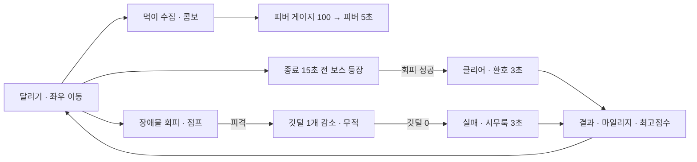

# **미니게임 Design Doc (v1.1) — 표준 게임 디자인 문서 템플릿**

_Universal Mini-Game Design Document Template v1.1_  
_작성 예시: **치킨런 v2 (chickenrunv2)** 최종 코드 기준 (Vite 8 + Three.js 0.186 + Firebase 13)_  
_원본: `Chickenrun_v2_Design_Doc.md` (GDD v2.0.0) → 실제 구현을 반영해 표준 템플릿으로 재구성_

---

## **0. 이 문서의 사용법**

### 0.1 두 문서의 역할

| 문서 | 무엇을 정하나 | 누가 쓰나 |
| :--- | :--- | :--- |
| `미니게임 표준 기획서 Form_1_6.md` | **모든 게임 공통의 방법과 규격**: 엔진 선정, 설치, 에셋 제작·파이프라인, i18n, 로그인/마이페이지, 배포, 검수 | 표준 (수정하지 않음) |
| **이 Design Doc** | **이 게임만의 내용**: 규칙, 캐릭터, 스테이지, 화면, 수치, 에셋 목록, 모션 목록 | 기획자가 게임마다 1부 작성 |

### 0.2 작성 규칙
- 각 장의 **`[템플릿]`** 블록을 채우고, **`[예시: chickenrunv2]`**는 참고 후 삭제하거나 남겨 둔다.
- **수치는 반드시 숫자로** 적는다("빠르게" 대신 "초당 12m"). 코딩 Agent는 이 문서의 수치를 그대로 상수로 옮긴다.
- 게임 데이터의 **ID·키는 영어**(`funny_chicken`, `stage01`), 화면 문구는 3개 언어 표로 적는다.
- 아직 정하지 않은 항목은 `TBD`로 남기고 비워 두지 않는다.
- 모든 표는 코드 데이터 테이블(`GameState.js` / ScriptableObject)과 1:1로 대응해야 한다.

### 0.3 목차
1. 게임 개요 · 2. 핵심 루프와 규칙 · 3. 화면 흐름과 UX 레이아웃 · 4. 플레이어 시스템 · 5. 캐릭터 · 6. 아이템 · 7. 장애물·적·NPC · 8. 보스/특수 이벤트 · 9. 스테이지 · 10. 점수·보상·진행 · 11. 카메라·월드·좌표계 · 12. 조작 · 13. 아트 디렉션과 에셋 목록 · 14. 모션 클립 요청서 · 15. 배경 요청서 · 16. 사운드 · 17. 다국어 문구 · 18. 계정·저장 데이터 · 19. 기술 아키텍처 · 20. 성능 예산 · 21. QA 테스트 계획 · 22. 배포·운영 · 23. 일정·작업 분할 · 부록 A. 6개 장르 적용 가이드 · 부록 B. chickenrunv2에서 얻은 교훈

---

## **1. 게임 개요 (Game Overview)**

```text
[템플릿]
- 게임명 (ko / en / ja):
- 영문 ID (kebab/lowercase):
- 한 줄 소개 (Elevator Pitch, 25자 이내):
- 장르 / 하위 장르:
- 핵심 재미 3가지:
- 타깃 플레이어 / 연령:
- 플랫폼: 모바일 웹(가로·세로) / 데스크톱 웹 / PWA / (네이티브 앱?)
- 판당 플레이 시간:
- 엔진 결정 (Form_1_6 13장 점수와 결론):
- 참고 게임 (레퍼런스 2~3개):
```

**[예시: chickenrunv2]**

| 항목 | 내용 |
| :--- | :--- |
| 게임명 | 치킨런 / Chicken Run / チキンラン |
| ID | `chickenrunv2` |
| 한 줄 소개 | 시골 농장을 달리며 먹이를 모으고, 끝까지 쫓아오는 심술 고양이를 따돌려라 |
| 장르 | 3D 엔드리스형 러너 (스테이지 클리어형), 수집 + 회피 |
| 핵심 재미 | ① 길이 굽이치며 흘러오는 속도감 ② 콤보·피버로 이어지는 수집 리듬 ③ 마지막 15초 보스 고양이 추격전 |
| 플랫폼 | 모바일 웹 가로·세로, 데스크톱 웹, PWA 설치 |
| 판당 시간 | 스테이지 90~120초 |
| 엔진 | **Vite + Three.js** — 웹 즉시 플레이(−2), 단순 충돌(−1), 고정 시점 빌보드(−1), 빠른 로딩(−2), AI Agent 단독 개발(−1) → 합계 −7 |
| 참고 | Subway Surfers, Temple Run, Crossy Road |

---

## **2. 핵심 루프와 규칙 (Core Loop & Rules)**

```text
[템플릿]
- 30초 루프 (매 순간 하는 일):
- 1판 루프 (시작 → 끝):
- 장기 루프 (판과 판 사이 성장/해금):
- 승리 조건 / 패배 조건:
- 라이프·체력 규칙:
- 난이도 상승 규칙 (시간/스테이지별 수치):
```



**[예시: chickenrunv2] 규칙 수치**

| 규칙 | 값 |
| :--- | :--- |
| 승리 | 스테이지 시간(90~120초) 종료까지 생존 + 보스 이벤트 통과 (Stage 1: 건초더미 3개 연속 회피) |
| 패배 | 깃털(라이프) 0개 |
| 라이프 | 깃털 3~6개 중 설정 화면에서 선택 (기본 4) |
| 피격 | 깃털 −1, 일정 시간 무적(깜빡임), 콤보 초기화 |
| 보스 등장 | 스테이지 종료 15초 전 (`BOSS_LEAD_TIME = 15`) |
| 난이도 | 스테이지별 기본 속도 12.0 → 14.4 → 15.6 → 18.0 → 19.2, 길 굴곡·언덕 계수 증가 |

---

## **3. 화면 흐름과 UX 레이아웃 (Screen Flow & Layout)**

### 3.1 화면 목록

```text
[템플릿] 화면마다: 화면 ID(영어) / 목적 / 주요 요소 / 진입·이탈 조건 / 3개 프로필별 차이
```

**[예시: chickenrunv2]**

| 화면 ID | 목적 | 주요 요소 |
| :--- | :--- | :--- |
| `intro` | 6초 인트로 영상 | 영상(muted 자동재생), 아이콘 사운드 토글, `Skip ⏩` |
| `login` | 인증 | 4개 방식 버튼 → 폼 뷰, 우상단 언어 버튼 |
| `nickname` | 게스트 별명 | 입력 2~12자, Enter 제출 |
| `title` | 메인 | 키아트, START, 캐릭터 선택, 스테이지 선택, 설정, 계정 바 |
| `settings` | 설정 | 깃털 3~6, BGM/SFX 볼륨, 시점 안내 |
| `game` | 플레이 | HUD(점수, 콤보, 피버 게이지, 깃털, 진행 바), 보스 배너, 조작 버튼, 일시정지 |
| `result` | 결과 | 성공/실패, 점수, 최고 점수, 획득 마일리지, 재도전/다음/타이틀 |
| `mypage` (모달) | 계정 | 아이디, 가입일, 마일리지, 플레이 수, 스테이지 최고점, 비밀번호/별명 변경 |
| `logout-confirm` (모달) | 로그아웃 확인 | 예/아니오, 게스트 경고 |

### 3.2 UX 프로필별 레이아웃 (Form_1_6 15장)

| 요소 | desktop | mobile-landscape | mobile-portrait |
| :--- | :--- | :--- | :--- |
| 게임 시점 | 가로 사이드 추적 | 가로 사이드 추적 | 세로 쿼터뷰 (화면 아래 1/3에 주인공) |
| 카메라 | fov 50, 높이 4.4, 뒤 7.0 | 동일 | fov 64, 높이 5.4, 뒤 8.0 |
| 조작 | 키보드 | 좌하단 점프, 우하단 4방향 | 하단 버튼 |
| HUD | 상단 가로 1줄 | 상단 좌·우 분산 | 상단 2줄 |
| 메뉴 버튼 | 가로 나열 | 가로 나열, 넘치면 2열 | 세로 또는 2열 그리드 |

### 3.3 레이아웃 규칙 (전 게임 공통)
- 글자가 넘치면 글씨를 줄이지 말고 **2열/2줄 배치**. 가로 메뉴가 겹치면 2열 그리드.
- 계정 바(우상단)가 모달과 겹치지 않도록 세로 화면 모달은 상단 여백 108px.
- 일본어는 `word-break: normal`, 한국어는 `keep-all`.

---

## **4. 플레이어 시스템 (Player)**

```text
[템플릿]
- 상태 목록 (상태 머신): 예) RUN, JUMP, HIT, CAUGHT, VICTORY
- 상태별 애니메이션 클립 (14장과 연결):
- 이동 물리 수치 (속도, 가속, 점프력, 중력, 이동 범위):
- 충돌 판정 (반지름/박스, 무적 시간):
- 파워업 효과 목록과 지속 시간:
```

**[예시: chickenrunv2]**

| 항목 | 값 / 공식 |
| :--- | :--- |
| 좌표 | `s`(길 거리), `lane` −1~+1, `y`(점프 높이) |
| 전후 이동 | 카메라 앞 거리 0.5~8.0, 속도 `3.0 + speed × 0.5` |
| 좌우 이동 | 속도 `1.6 + speed × 0.25` |
| 점프 | 힘 `13.5 + jumpPower × 0.8`, 중력 −38, 기본 1단(바나나 시 2단) |
| 상태 → 클립 | 달리기 `run`, 점프 `jump`(점프마다 재시작), 피격 `hit`, 잡힘/실패 `caught`, 클리어 `victory` |

---

## **5. 캐릭터 (Characters)**

```text
[템플릿] 5종 권장. 스탯은 1~5 정수, 코드 환산 공식은 4장.
| ID | 이름(ko/en/ja) | 역할 | 스탯1 | 스탯2 | 판정 | 특수 | 고유 스킬 | 대표 색(hex) | 키 높이(월드) |
```

**[예시: chickenrunv2]**

| ID | 이름 | 역할 | 속도 | 점프 | 판정 반지름 | 자석 | 고유 스킬 | 키 |
| :--- | :--- | :--- | :-: | :-: | :-: | :-: | :--- | :-: |
| `funny_chicken` | 퍼니 치킨 | 밸런스형 (주인공) | 3 | 3 | 0.70 | 3.0 | Somersault Guard: 점프 중 모든 장애물 무시 | 1.75 |
| `rooster_king` | 루스터 킹 | 묵직한 파워 | 2 | 2 | 0.90 | 4.0 | Heavy Break: 판당 1회 장애물 파괴(무피해) | 2.0 |
| `speedy_chick` | 스피디 칙 | 초고속 소형 | 5 | 5 | 0.45 | 2.2 | Feather Dash: 이동속도 +15% | 1.2 |
| `daffy_duck` | 대피 덕 | 물 특화 | 4 | 3 | 0.70 | 3.0 | Water Glide: 연못·미끄러운 바닥 감속 무시, 그 위에서 +20% | 1.6 |
| `turbo_turkey` | 터보 터키 | 분노 부스터 | 3 | 4 | 0.85 | 4.5 | Rage Booster: 피격 시 3초간 무적 고속 질주 | 1.95 |

- 각 캐릭터 = 기준 이미지 1장 + 초상화 2장(상반신·얼굴) + 모션 5클립.

---

## **6. 아이템 (Items & Pickups)**

```text
[템플릿]
| ID | 이름 | 분류(일반/파워업) | 점수 | 게이지 증가 | 지속(초) | 효과 | 출현 패턴 | 이미지 |
캐릭터 전용 수집품(캐릭터별 10종)을 쓸 경우 별도 표.
```

**[예시: chickenrunv2]**

| ID | 이름 | 분류 | 점수 | 피버+ | 지속 | 효과 |
| :--- | :--- | :--- | :-: | :-: | :-: | :--- |
| `rice` | 쌀 | 일반 | 10 | 4 | — | — |
| `corn` | 옥수수 | 일반 | 20 | 8 | — | — |
| `pepper` | 매운 고추 | 파워업 | 100 | 25 | 4.0 | `FIRE_BOOST` 무적 질주 |
| `banana` | 황금 바나나 | 파워업 | 100 | 25 | 8.0 | `DOUBLE_JUMP` 2단 점프 |
| `magnet` | 자석 씨앗 | 파워업 | 100 | 25 | 6.0 | `MAGNET_PULL` 주변 먹이 흡수 |

- 출현 패턴: 일렬(`straight`), 지그재그(`zigzag`), 곡선(`curve`). 아이템은 코드로 회전·부유(동영상 불필요).

---

## **7. 장애물 · 적 · NPC (Hazards & NPCs)**

```text
[템플릿]
| ID | 이름 | 행동(static/wander/rush/zone/...) | 크기(높이, 판정 길이·폭) | 행동 파라미터 | 피해 | 모션 클립 | 등장 스테이지 |
```

**[예시: chickenrunv2] (`ObstacleDefs`)**

| ID | 행동 | 높이 | 판정 (길이/폭) | 파라미터 | 클립 |
| :--- | :--- | :-: | :-: | :--- | :--- |
| `haystack` | static (점프로 넘기) | 1.5 | 0.55 / 0.75 | — | PNG |
| `fence` | static | 1.25 | 0.30 / 1.0 | — | PNG |
| `dog` | wander (좌우 배회) | 1.25 | 0.45 / 0.5 | 진폭 0.35, 주기 1.4, 접근 1.5 | `dog/move` |
| `duck` | wander | 1.0 | 0.35 / 0.4 | 진폭 0.45, 주기 0.9 | PNG |
| `pond` | zone (감속, 무피해) | 1.2 | 1.1 / 1.3 | 레인 ±0.45 | PNG |
| `cow_rushing` | rush (경고 후 돌진) | 1.9 | 0.6 / 0.7 | 속도 11, 경고 0.9초 | `cow_rushing/move` |

- 행동 4종(`static`, `wander`, `rush`, `zone`)은 장르를 바꿔도 대부분 재사용된다(부록 A).

---

## **8. 보스 / 특수 이벤트 (Boss & Set Pieces)**

```text
[템플릿]
- 보스 ID, 등장 시점, 승리 조건, 실패 조건
- 상태 머신 표: 상태 / 진입 조건 / 지속 시간 / 이동 / 클립 / 다음 상태
- 스테이지별 결말 연출
```

**[예시: chickenrunv2 — `BossCat` 상태 머신]**

| 상태 | 설명 | 클립 | 지속 |
| :--- | :--- | :--- | :-: |
| `ENTERING` | 화면 아래(뒤)에서 등장 | `run_back` | — |
| `HISSING` | 위협 | `hiss` | 1.3초 |
| `STALKING` | 플레이어 뒤 4.2 거리에서 추적 | `run_back` / 대각선 이동 시 `run_diag` | — |
| `CHARGING` | 웅크림(공격 예고) | `crouch` | 0.85초 |
| `LUNGING` | 덮치기 | `pounce` | 거리/속도 10 |
| `EVADED` | 헛침, 굴러감 | `miss_tumble` | 1.1초 |
| `SWIPE` | 잡았을 때 앞발질 | `swipe` | 0.9초 |
| `RETREAT` / `IDLE` | 물러나 도발 | `taunt` | — |
| `BURY_RUN` → `BURIED` | 건초더미 피날레, 파묻힘 | `run_back` → `faceplant` | 2.4초 |
| `DEFEATED` | 날아감 | `launched` | 1.2초 |
| `DIZZY` | 어지러움 | `dizzy` | 1.6초 |
| `GLOAT` | 플레이어 실패 시 의기양양 | `swipe` (loop) | 1.4초 |

- Stage 1: 건초더미 3개 연속 회피 → 고양이가 마지막 건초더미에 파묻힘. 다른 스테이지: 덮치기 4회 회피.
- 결말 원안(GDD): Stage 3 비단 이불, Stage 4 출렁다리, Stage 5 팝콘 기계 폭발.

---

## **9. 스테이지 (Stages)**

```text
[템플릿]
| ID | 이름(ko/en/ja) | 테마 | 난이도(★) | 기본 속도 | 시간(초) | 장애물 목록·가중치 | 원경/바닥/소품 (15장) | 안개색 | 보스 결말 |
```

**[예시: chickenrunv2]**

| ID | 이름 | 테마 | 속도 | 시간 | 장애물 | 보스 결말 |
| :-: | :--- | :--- | :-: | :-: | :--- | :--- |
| 1 | Farm Yard | 햇살 자갈길 | 12.0 | 90 | 건초3·울타리2·개2·오리2·연못1 | 건초더미에 파묻힘 |
| 2 | Fenced Meadow | 넓은 초록 목장 | 14.4 | 95 | 울타리, 돌진 소, 바위 | 목장 돌진 |
| 3 | Rustic Farmhouse | 마루·장판 실내 | 15.6 | 100 | 문지방, 엎질러진 차, 절굿공이 | 비단 이불에 말림 |
| 4 | Mountain Dirt Road | 노을 산길·절벽 | 18.0 | 110 | 바위, 낡은 차, 절벽 구멍 | 출렁다리 끊김 |
| 5 | Rural 5-Day Market | 팝콘 장터 | 19.2 | 120 | 사과상자, 수레, 인파 | 팝콘 기계 폭발 |

**스테이지 월드 데이터 (Stage 1)**: `curviness 1.0`, `hilliness 0.8`, `roadHalfWidth 2.2`, 소품 배치:

| 소품 | 높이 | 길 중심에서 거리 | 가중치 |
| :--- | :-: | :-: | :-: |
| apple_tree | 5.2 | 5.0~13 | 3 |
| fence_section | 1.2 | 3.4~4.0 | 3 |
| hay_stack | 1.7 | 3.8~8 | 2 |
| barrels | 1.4 | 3.6~7 | 1.5 |
| barn | 6.5 | 9~15 | 0.6 |
| duck_pond | 1.8 | 5.5~11 | 0.8 |

---

## **10. 점수 · 보상 · 진행 (Scoring & Progression)**

```text
[템플릿]
- 점수 공식, 콤보 규칙(유지 시간, 배율 구간), 게이지/피버 규칙
- 판 종료 보상 공식 (재화 이름, 성공 보너스)
- 해금 규칙 (스테이지, 캐릭터)
- 순위표 (사용 여부, 기준)
```

**[예시: chickenrunv2]**

| 항목 | 값 |
| :--- | :--- |
| 콤보 | 먹이를 2.0초 안에 이어 먹으면 유지 |
| 배율 | 5콤보 ×1.5, 10콤보 ×2.0, 20콤보 ×3.0 |
| 효과음 | 콤보마다 피치 ×1.05 (최대 2배) |
| 피버 | 게이지 100 도달 시 피버 5초 |
| 마일리지 | `floor(score / 10) + (성공 시 200)` |
| 기록 | 스테이지별 최고 점수, 누적 마일리지, 총 플레이 수 |
| 해금 | 현재 5개 스테이지 모두 열림(`unlockedStages`), 클리어 시 다음 스테이지 해금 로직 보유 |

---

## **11. 카메라 · 월드 · 좌표계 (Camera, World & Coordinates)**

```text
[템플릿]
- 게임 좌표계 정의 (단위, 축, 범위) 와 월드 변환 함수
- 카메라 프리셋 (프로필별 fov, 위치, 주시점, 추적 방식)
- 월드 구성 요소 (지형, 하늘, 안개, 소품, 조명)
- 엔티티 크기 기준 (주인공 키 = ? 월드 단위)
```

**[예시: chickenrunv2]**
- 좌표: `(s, lane, h)`. `RoadPath`가 해석식 곡선으로 끝없는 길 중심선을 만든다(청크 이음 없음, 기울기 < 0.25). `toWorld(s, lane, h)` 하나로 변환.
- 월드: `RoadMesh`(카메라 뒤 ~ 안개 끝까지 리본, 매 프레임 정점 갱신, V좌표 = 절대 거리) + `SkyLayer`(카메라에 붙은 원경판, 0.2배 시차) + `PropScatter`(소품 풀 재사용) + `THREE.Fog`(색 = `stage.json`의 `fogColor`).
- 크기: `ENTITY_SCALE 1.5`, `ROAD_SCALE 1.2`, 점프 시각 배율 `0.5 × ENTITY_SCALE`.
- 시점: 기기 방향을 따라 `LANDSCAPE` / `PORTRAIT` 프리셋 즉시 전환.

---

## **12. 조작 (Controls)**

```text
[템플릿]
| 동작 | 키보드 | 마우스 | 터치(가로) | 터치(세로) | 게임패드(선택) |
```

**[예시: chickenrunv2]**

| 동작 | 키보드 | 터치 |
| :--- | :--- | :--- |
| 좌우 이동 | `A/D`, `←/→` | 우하단 좌·우 버튼 |
| 전후 위치 | `W/S`, `↑/↓` | 우하단 위·아래 버튼 |
| 점프 | `Space` | 좌하단 점프 버튼 |
| 일시정지 | `Esc` / `P` | 일시정지 버튼 |

- 터치 버튼은 `pointerdown` 후 포인터 캡처를 해제해, 손가락이 옆 버튼으로 미끄러지면 방향이 바로 바뀐다.

---

## **13. 아트 디렉션과 에셋 목록 (Art Direction & Asset List)**

### 13.1 스타일 정의
```text
[템플릿]
- 스타일 문장 (모든 프롬프트 공통 STYLE BLOCK):
- 컬러 팔레트 (hex 5~8개, 스테이지별):
- 렌더링 방식 (Form_1_6 3.2: A 빌보드 / B 3D 모델 / C 혼합):
- 금지 사항: 외곽선, 바닥 그림자, 글자
```
**[예시]** STYLE BLOCK = `Stylized 3D Pixar-style cartoon, soft toon shading, vibrant warm colors, clean game asset.` / 렌더링 방식 A.

### 13.2 에셋 마스터 목록
```text
[템플릿] | 분류 | ID | 원본 파일(raw_*) | 런타임 파일(public/assets) | 생성 도구 | 상태(TBD/생성/처리/연결) |
```

**[예시: chickenrunv2 런타임 에셋]**

| 분류 | 경로 | 수량 |
| :--- | :--- | :-: |
| 인트로 | `videos/intro.mp4` | 1 |
| 타이틀 키아트 | `images/title/title_screen.png` | 1 |
| 캐릭터 기준 이미지 / 초상화 | `images/characters/*.png`, `characters/portraits/*.png`, `*_head.png` | 5 / 10 |
| NPC·고정 장애물 | `images/npcs/*.png`, `images/fixtures/*.png` | 5 / 3 |
| 아이템 | `images/items/item_*.png` | 5 |
| 모션 시트 | `anim/{id}/{action}.webp + .json`, `anim/manifest.json` | 42 클립 |
| 스테이지 월드 | `stages/stageNN/{sky,ground,grass}.webp`, `props/*.webp`, `stage.json` | 5 스테이지 |
| 스테이지 카드 | `images/backgrounds/stage0N.png` | 5 |
| 앱 아이콘 | `public/icons/mobile|desktop|source` | 세트 |

---

## **14. 모션 클립 요청서 (Motion Clip Request)** — Form_1_6 5장 규격 적용

```text
[템플릿]
1) 상태 vs 카메라 분석: 각 엔티티가 게임 화면에서 어느 방향으로 보이는가
2) 클립 표:
| # | 엔티티 | 동작 키 | loop/one-shot | normalize? | 카메라 각도 | 연결 상태 | 동작 블록 프롬프트 |
3) 공통 블록 (Form_1_6 5.6 그대로)
4) 상태 → 클립 매핑 표 (코드의 CLIP_FOR_STATE와 동일해야 함)
5) 좌우 반전으로 대체하는 클립 목록
```

**[예시: chickenrunv2 일부]**

| # | 엔티티 | 동작 | 종류 | normalize | 카메라 | 상태 |
| :-: | :--- | :--- | :--- | :-: | :--- | :--- |
| 1 | 주인공 5종 | `run` | loop | — | rear 3/4 | 달리기 |
| 2 | 주인공 5종 | `jump` | one-shot | — | rear 3/4 | 점프 |
| 3 | 주인공 5종 | `hit` / `caught` / `victory` | one-shot | — | rear 3/4 | 피격 / 실패 / 클리어 |
| 4 | cat_grumpy | `run_back` | loop | — | rear | `ENTERING`, `STALKING` |
| 5 | cat_grumpy | `run_diag` | loop | — | rear-right 3/4 (왼쪽은 반전) | 대각선 이동 |
| 6 | cat_grumpy | `pounce` | one-shot | ✅ | rear | `LUNGING` |
| 7 | cat_grumpy | `launched` | one-shot | ✅ | rear | `DEFEATED` |
| 8 | cow_rushing | `move` | loop | — | front 3/4 (다가옴) | `rush` |

- 전체 예시 문서: `Cat_Animation_Request.md`.

---

## **15. 배경 요청서 (Background Request)** — Form_1_6 6장 규격 적용

```text
[템플릿] 스테이지마다:
| 스테이지 | 원경 sky (내용, 색) | 바닥 ground_tile (길 재질 / 양옆) | 소품 6종 | 특수 구간 | 프롬프트 3개 (원경·바닥·소품 시트) |
```

**[예시: chickenrunv2 Stage 1 실제 프롬프트 요약]**
- 원경: "sunny rural Korean farm countryside … rolling green hills, tiny distant red barn and windmill … NO road … bottom 30% fades into haze … Colors: khaki #D2B48C, lawn green #7CFC00 … Wide 2:1"
- 바닥: "Strict top-down orthographic … straight dirt and gravel farm path … middle 50% of the width … top and bottom edges match perfectly … Tall 1:2"
- 소품: "6 separate farmyard props in a 3 by 2 grid: red barn, apple tree, rustic fence section, hay bales, barrels and crate, duck pond … plain light gray background … 3:2"

---

## **16. 사운드 (Audio)**

```text
[템플릿]
| 이벤트 | 소리 설명 | 방식(합성/파일) | 볼륨 채널(BGM/SFX) | 반복 여부 |
- BGM: 화면별 / 스테이지별 / 피버·보스 전용
- 오디오 잠금 해제 시점 (첫 사용자 입력)
```

**[예시: chickenrunv2]** 외부 음원 파일 없이 `SoundSynth`(Web Audio 오실레이터)로 합성: 먹기(콤보 피치 상승), 점프, 피격, 파워업, 피버, 클리어 팡파레(C 장조 화음), 실패음. BGM/SFX 볼륨은 설정에서 0~100%, 저장 데이터에 포함. 인트로 영상만 오디오 트랙 사용.

---

## **17. 다국어 문구 (Localization Strings)** — Form_1_6 8장

```text
[템플릿] 화면별로 키와 3개 언어를 표로 작성 → 그대로 strings.js에 옮긴다.
| key | ko | en | ja | 비고(변수 {n}, 최대 글자 수) |
```

**[예시]**

| key | ko | en | ja |
| :--- | :--- | :--- | :--- |
| `title.start` | 게임 시작 | Start | スタート |
| `hud.combo` | {n} 콤보 | {n} Combo | {n} コンボ |
| `char.funny_chicken.name` | 퍼니 치킨 | Funny Chicken | ファニーチキン |
| `lang.label` | English | Japanese | Korean |

- 버튼 문구는 언어별 **최대 글자 수**를 비고에 적는다(넘치면 2열 배치 결정).

---

## **18. 계정 · 저장 데이터 (Account & Save Data)** — Form_1_6 9장

```text
[템플릿]
- 사용할 로그인 방식 (기본 4종 전부 권장)
- 저장 필드 표: | 필드 | 형식 | 범위 | 로컬 | 클라우드 | 설명 |
- 보안 규칙 화이트리스트 (hasOnly 목록)
- 게스트 보관 기간, 회원 탈퇴 시 남기는 데이터
- 순위표 사용 여부
```

**[예시: chickenrunv2]**
- 로컬 키 `CHICKEN_RUN_V2_DATA`, 클라우드 `users/{uid}`, 동기화 대상 `PROGRESS_KEYS = mileage, totalRuns, highScores, selectedCharacter, featherLives, bgmVolume, sfxVolume` + 프로필(`displayName, nickname, accountId, provider, createdAt, updatedAt, expireAt`).
- 저장 지연 1.5초, `merge`. 게스트 100일 후 TTL 삭제. 순위표 없음.

---

## **19. 기술 아키텍처 (Technical Architecture)**

### 19.1 모듈 책임표 (chickenrunv2 실제 구조 = 표준 출발점)

| 모듈 | 책임 | 재사용성 |
| :--- | :--- | :--- |
| `core/GameManager` | 상태 전이(TITLE, PLAYING, PAUSED, STAGE_CLEAR, GAME_OVER), 메인 루프, 시스템 연결 | 구조 재사용 |
| `core/GameState` | 데이터 테이블(Characters, Stages, ItemTypes, Enums) | 내용 교체 |
| `core/SaveSystem` / `CloudSave` | 로컬 저장 / Firestore 동기화·프로필·비밀번호 변경·게스트 정리 | **그대로** |
| `core/i18n` / `strings` | 번역 엔진 / 사전 | 엔진 그대로, 사전 교체 |
| `core/UXMode` | 화면 프로필 판별·구독 | **그대로** |
| `core/firebase` | SDK 초기화, Analytics 이벤트 | 설정만 교체 |
| `renderer/GameRenderer` | 씬·카메라 프리셋·빌보드·플레이어 클립 선택 | 장르별 수정 |
| `world/*` | 길·바닥·하늘·소품·안개 | 러너·드론·종스크롤 슈팅 재사용 |
| `animation/AnimLibrary`, `SpriteAnimator` | 매니페스트 로드, 프레임 재생·반전 | **그대로** |
| `entities/*` | Player, Item, Obstacle(행동 4종), BossCat(상태 머신) | 패턴 재사용 |
| `managers/StageManager`, `ScoreManager` | 스폰·충돌·진행 / 콤보·피버 | 패턴 재사용 |
| `input/InputManager` | 키보드·터치 버튼 | 매핑만 수정 |
| `audio/SoundSynth` | 합성 효과음 | 그대로 / 확장 |
| `ui/AuthUI`, `AccountUI` | 로그인·가입 / 계정 바·마이페이지·로그아웃 | **그대로** |
| `ui/IntroCutscene`, `ResponsiveUIManager` | 인트로 / 메뉴·HUD·결과 | 화면 내용 수정 |
| `scripts/asset_pipeline.py`, `make_icons.py` | 에셋 자동화 / 아이콘 | **그대로** |

### 19.2 메인 루프 원칙
- `requestAnimationFrame` 1개, `dt` 상한(chickenrunv2: 0.1초)으로 탭 전환 후 순간이동 방지.
- 매 프레임 `new` 금지 → 오브젝트 풀(아이템, 장애물, 소품) 재사용.
- 상태가 `PAUSED`/결과일 때 월드 스크롤은 부드럽게 감속·정지.
- 디버그 전역: `window.__I18N__`, `window.__UX__`, `window.__CHICKEN_RUN_GAME__` → 자동 테스트가 이것으로 상태를 조작한다.

### 19.3 데이터 파일 형식
- `anim/manifest.json`, `anim/{id}/{action}.json`, `stages/stageNN/stage.json` — Form_1_6 7.4~7.5 형식 고정. 장르가 달라도 파이프라인 출력 형식은 바꾸지 않는다.

---

## **20. 성능 예산 (Performance Budget)**

| 항목 | 목표 |
| :--- | :--- |
| 프레임 | 중급 모바일 60fps (최저 45) |
| 픽셀 비율 | `min(devicePixelRatio, 2)` |
| 초기 JS 번들 | 1MB 이하 (gzip 300KB 내외) |
| 첫 화면 | 3초 이내, 스테이지 에셋은 진입 시 지연 로딩 |
| 텍스처 | WebP, 시트 폭 ≤ 4096, 스테이지당 총 8MB 이하 |
| 드로우콜 | 100 이하 (소품 풀, 공유 머티리얼) |
| 인트로 영상 | 1.5MB 목표 |

---

## **21. QA 테스트 계획 (Test Plan)**

```text
[템플릿] | 테스트 | 방법 | 범위 | 합격 기준 |
```

**[예시: chickenrunv2에서 실제 사용한 자동 테스트 (Playwright, `.cache/tools`)]**

| 도구 | 내용 |
| :--- | :--- |
| `uxaudit.mjs` | 3 프로필 × 3 언어 × 전 화면 캡처, 글자 넘침·겹침·줄바꿈 자동 탐지 |
| `i18ntest.mjs` | 언어 전환 후 키 노출·빈 문구 검사, 화면별 스크린샷 |
| `dbtest.mjs` | 실서비스에서 가입 → 저장 → 새로고침 → 복원 → 규칙 위반 거부 (12항목) |
| `cleanup.mjs` | 테스트 계정·문서 정리 |
| `pwacheck.mjs` | 매니페스트·아이콘·설치 가능 여부 |
| `find404.mjs` | 누락 에셋 탐지 |
| `langbtn.mjs`, `introshot.mjs` | 언어 버튼 표기, 인트로 화면 확인 |

- 수동: 실제 휴대폰 가로·세로 회전, 느린 네트워크, Google 팝업 차단 상황.
- Form_1_6 19장 Q1~Q24로 최종 판정.

---

## **22. 배포 · 운영 (Deploy & Ops)**

| 항목 | chickenrunv2 |
| :--- | :--- |
| 저장소 | GitHub `main` |
| 호스팅 1 | Firebase Hosting (`npx vite build` 후 `firebase deploy --only hosting`) |
| 호스팅 2 | Vercel (push 자동 배포, Vite 프리셋, 환경변수 없음) |
| 승인 도메인 | localhost, web.app, firebaseapp.com, vercel.app |
| 모니터링 | Firebase Analytics 이벤트(`trackEvent`), Firestore 사용량, Auth 사용자 수 |
| 데이터 정리 | 게스트 TTL(`expireAt`) 자동 삭제 |

---

## **23. 일정 · 작업 분할 (Milestones)**

| 마일스톤 | 내용 (Form_1_6 18장 단계) | 산출물 |
| :--- | :--- | :--- |
| M0 | 엔진 결정, 설치, 골격, 계정, i18n (0~4) | 로그인되는 빈 게임 |
| M1 | 임시 도형 프로토타입 (5) | 재미 검증 |
| M2 | 캐릭터·NPC 모션, 배경 제작과 파이프라인 (6~8) | 그래픽 적용 빌드 |
| M3 | 스테이지 5종, 보스, 엔딩, 관리자 도구 (9~10) | 콘텐츠 완성 |
| M4 | UX 감사, PWA, 배포, DB 검증 (11~12) | 실서비스 |

---

## **부록 A. 6개 장르 적용 가이드**

각 게임은 이 Design Doc 템플릿을 복사해 작성하되, 아래 표를 출발점으로 쓴다. 공통: 계정·i18n·저장·UXMode·PWA·배포·에셋 파이프라인은 chickenrunv2에서 그대로 가져온다.

### A.1 3D 테니스 게임
| 항목 | 설계 출발점 |
| :--- | :--- |
| 핵심 루프 | 서브 → 랠리(이동 + 타이밍 스윙) → 포인트 → 게임/세트 |
| 승패 | 1세트 4~6게임 또는 타이브레이크, 듀스 규칙 |
| 엔진 | Unity 권장(공 스핀·바운드 물리, 선수 3D 모델). 웹 전용이면 Three.js + Rapier |
| 좌표 | 실제 미터 `(x 코트 폭, z 코트 길이, y 높이)`, 코트 23.77×10.97m, 네트 0.914m |
| 물리 | 중력 9.81, 공기저항, 마그누스(톱스핀/슬라이스), 바운드 반발계수(코트 재질별 0.75~0.85) |
| 판정 | 스윙 타이밍 창(Perfect ±50ms / Good ±120ms) → 방향·속도 결정, 인/아웃 라인 판정 |
| 카메라 | 방송형(베이스라인 뒤 상공), 서브 시 클로즈업 |
| 캐릭터 5종 | 스탯: 속도, 파워, 컨트롤, 스핀, 체력 |
| 모션 | Form_1_6 5.3 테니스 목록 (방식 B 3D 모델 + Mixamo 권장) |
| 배경 | 코트 표면(비반복) + 경기장 관중석 파노라마 + 네트·광고판 |
| 스테이지 5종 | 하드(도심), 클레이(유럽), 잔디(정원), 실내, 야간 결승 |
| AI 상대 | 공 낙하점 예측 → 이동 → 난이도별 반응 지연·실수 확률 |

### A.2 타워디펜스 게임
| 항목 | 설계 출발점 |
| :--- | :--- |
| 핵심 루프 | 타워 배치 → 웨이브 방어 → 재화 획득 → 업그레이드 |
| 승패 | 모든 웨이브 방어 / 기지 체력 0 |
| 엔진 | Vite + Three.js (탑다운 고정, 빌보드 스프라이트) |
| 좌표 | 그리드 `(col, row)` + 적 경로 웨이포인트(또는 A* 경로 탐색) |
| 데이터 | 타워: 사거리, 공격속도, 피해, 비용, 업그레이드 3단계 / 적: 체력, 속도, 방어, 보상 |
| 웨이브 | 웨이브 표(시간, 적 ID, 수, 간격), 10~20웨이브, 마지막 보스 |
| 모션 | 타워 `idle/attack/upgrade`, 적 `walk/hit/die` (탑다운 45°, 4방향이면 2방향 제작 + 반전) |
| 배경 | 탑다운 타일셋(길, 잔디, 물, 바위) + 장식 소품, 흐름 없음 |
| 재사용 | `SpriteAnimator`, 오브젝트 풀, `Obstacle` 행동 → 적 행동 |

### A.3 슈팅 게임 (종스크롤 기준)
| 항목 | 설계 출발점 |
| :--- | :--- |
| 핵심 루프 | 이동 + 자동/수동 사격 → 적 격파 → 파워업 → 보스 |
| 엔진 | Vite + Three.js (`InstancedMesh`로 탄 수백 개). 탄 수천 개면 Unity 검토 |
| 좌표 | 화면 평면 `(x, y)` + 스크롤 거리 |
| 시스템 | 탄막 패턴 데이터(원형, 부채꼴, 조준탄), 히트박스는 기체보다 작게, 폭탄(전체 공격) |
| 모션 | 기체 `fly_idle/bank_left(반전)/boost/hit/explode`, 적 `fly/fire/explode`, 보스 페이즈별 |
| 배경 | 다층 시차(원경 우주·하늘, 중경 구름, 바닥 세로 반복 타일) — chickenrunv2 바닥 스크롤 재사용 |
| 보스 | `BossCat` 상태 머신 패턴을 페이즈 머신으로 확장 |

### A.4 골프 퍼팅 게임
| 항목 | 설계 출발점 |
| :--- | :--- |
| 핵심 루프 | 그린 읽기(경사 표시) → 조준 → 파워 → 굴림 → 홀인/재시도 |
| 승패 | 홀별 타수(파 기준), 9홀 합계 |
| 엔진 | Vite + Three.js (물리는 직접 구현) |
| 물리 | 높이맵 `h(x, z)`의 기울기로 가속, 구름 마찰(그린 스피드 = Stimp 8~13 환산), 홀컵 포착 속도 상한 |
| UI | 드래그로 방향·세기, 예상 경로 점선(난이도에 따라 길이 제한), 경사 화살표/그리드 |
| 모션 | `address/putt_short/putt_long/celebrate/disappointed` (사이드 또는 뒤 3/4) |
| 배경 | 그린 텍스처 + 높이맵 + 스카이박스, 주변 나무·벙커 소품 |

### A.5 골프 드라이버 게임
| 항목 | 설계 출발점 |
| :--- | :--- |
| 핵심 루프 | 클럽·방향 선택 → 스윙 게이지(파워·정확도) → 탄도 비행 → 낙하·굴림 → 비거리/정확도 점수 |
| 엔진 | 웹이면 Three.js(탄도 해석식), 네이티브·사실 물리면 Unity |
| 물리 | 초기 속도·발사각·백스핀·사이드스핀 → 항력·양력·바람 적분, 지면(페어웨이/러프/벙커) 반발·마찰 |
| UI | 3클릭 게이지(시작·파워·임팩트) 또는 스와이프 스윙, 바람 표시, 낙하 지점 미리보기 |
| 카메라 | 뒤 추적 → 공 추적 → 낙하 지점 컷 |
| 모션 | `address/backswing/downswing_impact/follow_through/watch_ball/celebrate/slice_reaction` (뒤 3/4) |
| 배경 | 스카이박스 + 원거리 산, 페어웨이·러프·벙커 타일 세트, 거리 표지판·나무·갤러리 |

### A.6 드론 폭탄 게임
| 항목 | 설계 출발점 |
| :--- | :--- |
| 핵심 루프 | 비행(이동·고도) → 목표 탐색 → 조준 → 폭탄 투하 → 파괴 점수, 대공 공격 회피 |
| 엔진 | Vite + Three.js (chickenrunv2 바닥 스크롤·장애물·보스 구조 재사용) |
| 좌표 | 러너의 `(s, lane, h)`를 `(전진 거리, 좌우, 고도)`로 그대로 사용 가능 |
| 물리 | 폭탄 = 드론 속도 상속 + 중력 포물선, 조준점 = 예상 낙하 지점 표시 |
| 적/목표 | 정지 목표(static), 이동 차량(wander), 대공포(조준 후 발사 = rush 변형), 보스 요새 |
| 모션 | 드론 `hover/fly_forward/bank_left(반전)/drop_bomb/hit/crash`, 목표 `move/alert/destroyed` (탑다운 45°) |
| 배경 | 탑다운 도시/지형 반복 타일(네 방향 이음매) + 하늘 원경 + 건물 지붕 소품 |

---

## **부록 B. chickenrunv2 개발에서 얻은 교훈 (반드시 읽기)**

| # | 문제 | 원인 | 표준 해결 |
| :-: | :--- | :--- | :--- |
| 1 | 기획서는 Unity C#, 실제 코드는 Three.js | 기획 단계에서 엔진을 확정하지 않음 | Form_1_6 13장 엔진 결정을 먼저 기록 |
| 2 | 한 장짜리 배경은 아무리 스크롤해도 3D 느낌이 없음 | 원경·바닥·소품이 한 그림에 섞임 | 3층 분리 (Form_1_6 6장) |
| 3 | AI 바닥 타일에 원근이 들어감 | 프롬프트가 약함 | "strict top-down orthographic, NO perspective" 강조, `perspectiveWarning` 검사, `ROAD_OVERRIDES` |
| 4 | 동영상 피사체 크기가 계속 변해 프레임이 튐 | 카메라 고정 안 됨 | "camera tracks … same size" 문장 + `normalize` 모드 |
| 5 | 뒤에서 쫓는 고양이를 정면 동영상으로 만듦 | 게임 카메라 각도를 고려하지 않음 | 상태 vs 카메라 분석표를 먼저 작성 |
| 6 | 일본어 문구가 버튼 밖으로 넘침 | `word-break: keep-all` | 일본어는 `normal`, 넘치면 2열 |
| 7 | 중앙 배너가 좁게 찌그러짐 | `left:50%` 절대배치 폭 제한 | `width:max-content; max-width:calc(100% - 24px)` |
| 8 | 세로 화면에서 계정 바가 모달을 가림 | z-index·여백 미설계 | 모달 상단 여백 108px |
| 9 | Vercel 배포 후 Google 로그인 실패 | 승인된 도메인 누락 | 배포 도메인을 Firebase 승인된 도메인에 추가 |
| 10 | 저장이 거부됨 | 규칙 화이트리스트에 새 필드 없음 | 필드 추가 시 `firestore.rules`의 `hasOnly`도 함께 수정·배포 |
| 11 | 언어를 바꿔도 에러 메시지가 그대로 | 메시지를 문자열로 저장 | 키를 저장하고 언어 변경 시 재번역 |
| 12 | 손가락이 옆 버튼으로 미끄러지면 입력이 멈춤 | 터치 포인터 캡처 | `releasePointerCapture` |
| 13 | 아이콘 가장자리에 흰 테두리 | 배경 제거 불완전 | 외곽에서 flood fill로 흰색 근접 픽셀만 제거 (`make_icons.py`) |
| 14 | Firebase CLI 401 오류 | 토큰 만료 | `firebase-tools projects:list`로 재인증 |
| 15 | 헤드리스 테스트에서 인트로가 바로 사라짐 | 자동재생 정책 | 테스트에서 인트로를 강제 표시하거나 디버그 전역으로 상태 지정 |
| 16 | `dist/`가 저장소에 섞임 | `.gitignore` 누락 | `dist/`, `.cache/` 무시, 빌드는 배포 단계에서 |

---
**문서 정보**  
- 버전: Design Doc v1.1 (표준 템플릿 + chickenrunv2 작성 예)  
- 동반 문서: `미니게임 표준 기획서 Form_1_6.md`  
- 적용 대상: 3D 테니스, 타워디펜스, 슈팅, 골프 퍼팅, 골프 드라이버, 드론 폭탄 및 이후 모든 미니게임
